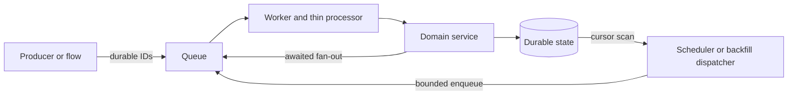

# Backend Queue Authoring Checklist

Use this checklist when adding or changing a Voucha GlideMQ queue, worker, processor, flow, job
payload, retry policy, scheduler, backfill, or worker placement. Generic GlideMQ API syntax belongs
in the installed `glide-mq` skill; this page owns Voucha's package, durability, and validation
contracts.

## Priority kinds

Declare one priority kind when creating each queue: `none` accepts only the zero priority, while
`ranked` accepts a bounded range and has a default. Never mix the two kinds in one queue. Task jobs
use the default and may use other tiers below the dispatcher tier when a domain ranks its own work;
dispatchers, cleanup, recovery, and backfills use the dispatcher tier so they run behind the tasks
they create.
In [glide-mq's priority order](https://github.com/avifenesh/glide-mq/blob/main/docs/USAGE.md),
ranked jobs run before priority-0 FIFO jobs, so a mixed queue can starve its 0 jobs.

## Queue boundaries

Prefer fewer, shared queues: each queue costs a blocking connection, timers, and metrics.

- **Share by default.** Background work of the same worker class goes into that class's shared
  queue as a domain. Express domain limits per job: group (`ordering`) `concurrency`, `rateLimit`,
  or `tokenBucket` in place of a separate queue, `setGlobalConcurrency`, or a queue-wide
  `limiter`; per-job `lockDuration` and `timeout` in place of worker-level values.
- **Operate per domain.** A shared queue needs pause, retry, and stats per domain, with pausing as a
  domain-control database field, not `Queue.pause()`. The [background queue](../overview/architecture/queues/README.md)
  has them ([#2855](https://github.com/vouchington/vouchington/issues/2855)): register the domain in its
  registry rather than adding a queue, and never throw `RateLimitError` or call `worker.rateLimit()`
  from a shared worker, because either idles every domain on it. Defer the job with
  `job.rateLimitGroup` or `job.moveToDelayed` (the worker converts a thrown `RateLimitError` for you).
- **Add a queue only when sharing cannot work:** a different worker class; latency-critical work
  a person is watching, such as login emails or upload finalization, which gets a queue holding
  only that work; a limiter a group cannot express, such as a token limiter charged by actual
  usage; a domain that needs both a domain-wide concurrency cap and per-entity ordering keys,
  since a job has one ordering key; a batch worker; or a distinct runtime.
- **Never wait on a job result.** New code never makes a request or job wait for another job's
  result (`addAndWait`, `waitUntilFinished`, polling a job's return value); return a pending resource
  and let clients poll. The crawler's remaining wait path is being removed in
  [#2853](https://github.com/vouchington/vouchington/issues/2853).
- **Fan out in pages.** Dispatchers, backfills, and other fan-out jobs enqueue one bounded page,
  then continue through a cursor. Ranked priority orders only jobs promoted together, so a large
  batch already in the ready list delays every later task in the shared queue, whatever its
  priority.
- **Throttle our own datastores with concurrency.** Use a `limiter` or group `rateLimit` only to
  stay under an external service's rate limit.
- **When merging,** namespace job names, deduplication IDs, job IDs, scheduler IDs, and ordering
  keys by domain, and size the worker for the combined load. A job that already needs an ordering
  key keeps it, namespaced, and gives up any domain-wide group cap.

For sweeps and cleanup jobs, apply the [bounded-iteration adapter](../../.agents/skills/bounded-iteration/SKILL.md).

## Placement and validation

- Queue configuration, payload types, enqueue APIs, and scheduler registration live in
  [`backend/queues/<domain>/`](../../backend/queues/) (never importing workers); registrations and
  thin processors live in [`backend/workers/<domain>/`](../../backend/workers/), with fetching,
  authorization, durable writes, and business logic in services. Worker placement is data-driven in
  [`worker-queue-policy.json`](../../backend/modules/worker-queue-inventory/worker-queue-policy.json).
- Test at the service boundary with real PostgreSQL, Valkey, and GlideMQ; never mock internal queues,
  workers, services, or data stores. Find an enqueued job with `searchJobs` or by id, not
  `getJobs('waiting')`; see [GlideMQ testing](../development/testing/backend/glide-mq-testing.md).
- Update the domain queue/worker README, the
  [queue inventory](../overview/architecture/queues/README.md), and, when applicable, the replayability
  matrix, scheduled/backfill registries, and placement policy.

## Contents

- [Define a replay-safe job](reference-backend-queues-define-a-replay-safe-job.md)
- [Durable transition matrix](reference-backend-queues-durable-transition-matrix.md)
- [Schedulers, flows, and backfills](reference-backend-queues-schedulers-flows-and-backfills.md)
