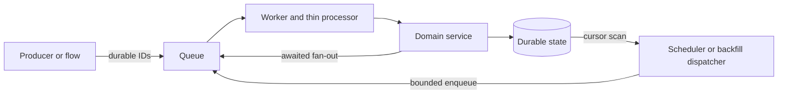

# Backend Queue Authoring Checklist

Use this checklist when adding or changing a Voucha GlideMQ queue, worker, processor, flow, job
payload, retry policy, scheduler, backfill, or worker placement. Generic GlideMQ API syntax belongs
in the installed `glide-mq` skill; this page owns Voucha's package, durability, and validation
contracts.

## Priority kinds

Declare one priority kind when creating each queue: `none` accepts only 0, while `ranked`
accepts 1 through 2048 and defaults to 10. Never mix the two kinds in one queue. Reserve
priority 1 for work a user is waiting on; use 100 for background cleanup, recovery, and
backfills. In [glide-mq's priority order](https://github.com/avifenesh/glide-mq/blob/main/docs/USAGE.md),
ranked jobs run before priority-0 FIFO jobs, so a mixed queue can starve its 0 jobs.

## Queue boundaries

Each queue costs a blocking connection, timers, and metrics, so merge queues whose worker class,
limiter, concurrency, lock duration, and priority kind match and whose job names do not collide.
Keep transactional work, meaning jobs a user is actively waiting on such as login tokens and
verification emails, in its own queue. Ranked priority orders only the jobs promoted together, so
a ranked job enqueued later still waits behind every job already in the ready list.

For sweeps and cleanup jobs, apply the [bounded-iteration adapter](../../.agents/skills/bounded-iteration/SKILL.md).

## Contents

- [Place each responsibility](reference-backend-queues-place-each-responsibility.md)
- [Define a replay-safe job](reference-backend-queues-define-a-replay-safe-job.md)
- [Durable transition matrix](reference-backend-queues-durable-transition-matrix.md)
- [Schedulers, flows, and backfills](reference-backend-queues-schedulers-flows-and-backfills.md)
- [Test and document](reference-backend-queues-test-and-document.md)
- [See also](reference-backend-queues-see-also.md)
