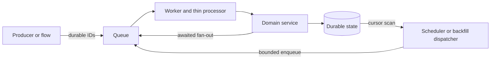

# Backend Queue Authoring Checklist

Use this checklist when adding or changing a Voucha GlideMQ queue, worker, processor, flow, job
payload, retry policy, scheduler, backfill, or worker placement. Generic GlideMQ API syntax belongs
in the installed `glide-mq` skill; this page owns Voucha's package, durability, and validation
contracts.

## Priority kinds

Declare one priority kind when creating each queue: `none` accepts only the zero priority, while
`ranked` accepts a bounded range and has a default. Never mix the two kinds in one queue. Task jobs
use the default and may use other tiers below the dispatcher tier when a domain ranks its own work;
dispatchers, cleanup, recovery, and backfills use the dispatcher tier so they run behind the tasks
they create.
In [glide-mq's priority order](https://github.com/avifenesh/glide-mq/blob/main/docs/USAGE.md),
ranked jobs run before priority-0 FIFO jobs, so a mixed queue can starve its 0 jobs.

## Queue boundaries

Job payloads pass identifiers and load the required state in the processor. Mark a job
`sensitive: true` when its payload contains secrets or personal data; this enforces immediate
removal after completion and ordinary processor failure. GlideMQ's terminal stalled-job path
currently retains the payload despite `removeOnFail: true`; track the upstream fix in
[#3306](https://github.com/vouchington/vouchington/issues/3306), and do not rely on queue retention
as protection for sensitive data after a worker repeatedly stalls.

Prefer fewer, shared queues: each queue costs a blocking connection, timers, and metrics.

- **Share by default.** Background work of the same worker class goes into that class's shared
  queue as a domain. Express domain limits per job: group (`ordering`) `concurrency`, `rateLimit`,
  or `tokenBucket` in place of a separate queue, `setGlobalConcurrency`, or a queue-wide
  `limiter`; per-job `lockDuration` and `timeout` in place of worker-level values.
- **Operate per domain.** A shared queue needs pause, retry, and stats per domain, with pausing as a
  domain-control database field, not `Queue.pause()`. The [background queue](../overview/architecture/queues/README.md)
  has them ([#2855](https://github.com/vouchington/vouchington/issues/2855)): register the domain in its
  registry rather than adding a queue, and never throw `RateLimitError` or call `worker.rateLimit()`
  from a shared worker, because either idles every domain on it. Defer the job with
  `job.rateLimitGroup` or `job.moveToDelayed` (the worker converts a thrown `RateLimitError` for you).
- **Add a queue only when sharing cannot work:** a different worker class; latency-critical work
  a person is watching, such as login emails or upload finalization, which gets a queue holding
  only that work; a limiter a group cannot express, such as a token limiter charged by actual
  usage; a domain that needs both a domain-wide concurrency cap and per-entity ordering keys,
  since a job has one ordering key; a batch worker; or a distinct runtime.
- **Never wait on a job result.** Requests and jobs do not wait for another job's result
  (`addAndWait`, `waitUntilFinished`, or polling a job's return value). Return a pending resource
  and let clients poll its durable status. A dependent job resumes from persisted state after the
  producer's outcome.
- **Fan out in pages.** A job that enqueues one job per row of a query pages through a unique
  cursor and checks the target queue's depth before each page. HTTP routes enqueue one dispatcher,
  never the rows. Use the shared paged-dispatcher helper with DynamicConfig page, queue-depth,
  and backoff limits; dispatchers retry indefinitely. Dispatcher state lives in job data, not
  PostgreSQL. The depth threshold is a soft admission limit: each admitted page may cross it.
  It includes dispatcher jobs. A threshold below an unread control backlog conservatively
  blocks admission until an operator raises it; already-receipted pages can still finish cleanup.
  Shared workers preserve ordinary jobs' stall budget while allowing dispatchers to resume.
  Record ownership of row-admission fences before bulk enqueue; clean them in bounded batches
  after the page receipt is durable, preserving each row queue's failure-retention policy.
  If a fresh sweep must re-admit a retained terminal row, use a dedicated connection to WATCH
  its native job hash and remove it through GlideMQ's native function in the same transaction.
  A concurrent retry must abort removal; never remove a live job after a separate state check.
  Ranked priority orders only jobs promoted together, so a large
  batch already in the ready list delays every later task in the shared queue, whatever its
  priority.
- **Give each continuation a new identity.** The shared queue factory rejects a processor that
  re-adds its active job ID or deduplication ID, because GlideMQ silently drops that add.
- **Schedule the real job directly.** The shared worker lease skips overlapping scheduler runs,
  so a trampoline job or per-scheduler deduplication is unnecessary.
- **Throttle our own datastores with concurrency.** Use a `limiter` or group `rateLimit` only to
  stay under an external service's rate limit.
- **Honor upstream rate limits.** Classify an external 429 and its `Retry-After` through
  `@modules/queue-errors` so the affected job waits without consuming a domain failure attempt.
- **Record the intent before an effect.** A paid or otherwise non-idempotent external call needs a
  durable receipt before dispatch. A retry must reuse its recorded result or a provider-supported
  idempotency key; an ambiguous billed attempt must not be sent again blindly. A resend blocked
  after only positively unbilled capacity failures can release its pending reservation.
- **Mark moderation summaries after local send checks and before SES.** A failed preference or
  suppression lookup can retry without a send mark. A definitive sending-rate rejection clears
  the mark for a queue retry; an unknown send outcome keeps it to prevent duplicate mail.
  The mark-first contract accepts a lost summary if execution stops or the mark acknowledgement
  is lost before dispatch. An unconfirmed mark cannot safely be cleared without proving ownership.
- **When merging,** namespace job names, deduplication IDs, job IDs, scheduler IDs, and ordering
  keys by domain, and size the worker for the combined load. A job that already needs an ordering
  key keeps it, namespaced, and gives up any domain-wide group cap.

For sweeps and cleanup jobs, apply the [bounded-iteration adapter](../../.agents/skills/bounded-iteration/SKILL.md).

## Replay and payload safety

- **Replay only idempotent "ensure" effects.** A reconciler or sweep re-runs forever, so an on-create effect in it repeats.
- **A sweep never writes the rows it selects by `updated_at`, unless the write is a lease.** Otherwise the write bumps its own trigger and the sweep never ends. A bounded stale-row recovery sweep with a fixed staleness cutoff may touch the rows it enqueues, because the touch makes them ineligible until they stall again.
- **Every state-driven sweep and reconciler has a convergence test:** a second run writes and enqueues nothing. Recurring jobs that do unconditional periodic work (such as a scheduled materialized-view refresh) are exempt.
- **Make a paid or external call idempotent.** A stall retries the job and pays twice. Pass a provider idempotency key, or persist a claim/state row and reconcile it after a lost response; a bare receipt row does not prevent a repeat charge. See the [durable-transition matrix](reference-backend-queues-durable-transition-matrix.md).
- **No secrets or PII in payloads.** `removeOnComplete`/`removeOnFail` retention keeps payloads in Valkey, readable by anyone with queue access, and `scrubJobData` scrubs only failure logs, not stored data. Pass ids and load the data in the processor; login tokens, invite codes, and presigned URLs stay in the processor. Terminal removal does not protect a payload: a job that stalls past its limit stays in the failed set until the upstream GlideMQ fix tracked in [#3306](https://github.com/vouchington/vouchington/issues/3306); see the [replay-safe job reference](reference-backend-queues-define-a-replay-safe-job.md) for the narrow exception.

## Placement and validation

- Queue configuration, payload types, enqueue APIs, and scheduler registration live in
  [`backend/queues/<domain>/`](../../backend/queues/) (never importing workers); registrations and
  thin processors live in [`backend/workers/<domain>/`](../../backend/workers/), with fetching,
  authorization, durable writes, and business logic in services. Worker placement is data-driven in
  [`worker-queue-policy.json`](../../backend/modules/worker-queue-inventory/worker-queue-policy.json).
- Test at the service boundary with real PostgreSQL, Valkey, and GlideMQ; never mock internal queues,
  workers, services, or data stores. Find an enqueued job with `searchJobs` or by id, not
  `getJobs('waiting')`; see [GlideMQ testing](../development/testing/backend/glide-mq-testing.md).
- Update the domain queue/worker README, the
  [queue inventory](../overview/architecture/queues/README.md), and, when applicable, the replayability
  matrix, scheduled/backfill registries, and placement policy.

## Contents

- [Define a replay-safe job](reference-backend-queues-define-a-replay-safe-job.md)
- [Durable transition matrix](reference-backend-queues-durable-transition-matrix.md)
- [Schedulers, flows, and backfills](reference-backend-queues-schedulers-flows-and-backfills.md)
