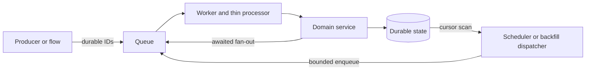

# Backend Queue Authoring Checklist

Use this checklist when adding or changing a Voucha GlideMQ queue, worker, processor, flow, job
payload, retry policy, scheduler, backfill, or worker placement. Generic GlideMQ API syntax belongs
in the installed `glide-mq` skill; this page owns Voucha's package, durability, and validation
contracts.

## Priority kinds

Declare one priority kind when creating each queue: `none` accepts only 0, while `ranked`
accepts 1 through 2048 and defaults to 10. Never mix the two kinds in one queue. Task jobs use
10; dispatchers, cleanup, recovery, and backfills use 100 so they run behind the tasks they
create. In [glide-mq's priority order](https://github.com/avifenesh/glide-mq/blob/main/docs/USAGE.md),
ranked jobs run before priority-0 FIFO jobs, so a mixed queue can starve its 0 jobs.

## Queue boundaries

Prefer fewer, shared queues: each queue costs a blocking connection, timers, and metrics.

- **Share by default.** Background work of the same worker class goes into that class's shared
  queue as a domain. Express domain limits per job: group (`ordering`) `concurrency`, `rateLimit`,
  or `tokenBucket` in place of a separate queue, `setGlobalConcurrency`, or a queue-wide
  `limiter`; per-job `lockDuration` and `timeout` in place of worker-level values.
- **Operate per domain.** Pause, retry, and stats work per domain, and pausing is a domain-control
  database field, not `Queue.pause()`.
- **Add a queue only when sharing cannot work:** a different worker class; latency-critical work
  a person is watching, such as login emails or upload finalization, which gets a queue holding
  only that work; a limiter a group cannot express, such as a token limiter charged by actual
  usage; a batch worker; or a distinct runtime.
- **Never wait on a job result.** No request or job calls `addAndWait`, `waitUntilFinished`, or an
  `enqueue*AndWait` helper; return a pending resource and let clients poll.
- **Fan out in pages.** Dispatchers, backfills, and other fan-out jobs enqueue one bounded page,
  then continue through a cursor. Ranked priority orders only jobs promoted together, so a large
  batch already in the ready list delays every later task in the shared queue, whatever its
  priority.
- **Throttle our own datastores with concurrency.** Use a `limiter` or group `rateLimit` only to
  stay under an external service's rate limit.
- **When merging,** namespace job names, deduplication IDs, job IDs, scheduler IDs, and ordering
  keys by domain, and size the worker for the combined load. A job has one ordering key, so a job
  that already needs one keeps its own key, namespaced.

For sweeps and cleanup jobs, apply the [bounded-iteration adapter](../../.agents/skills/bounded-iteration/SKILL.md).

## Contents

- [Place each responsibility](reference-backend-queues-place-each-responsibility.md)
- [Define a replay-safe job](reference-backend-queues-define-a-replay-safe-job.md)
- [Durable transition matrix](reference-backend-queues-durable-transition-matrix.md)
- [Schedulers, flows, and backfills](reference-backend-queues-schedulers-flows-and-backfills.md)
- [Test and document](reference-backend-queues-test-and-document.md)
- [See also](reference-backend-queues-see-also.md)
