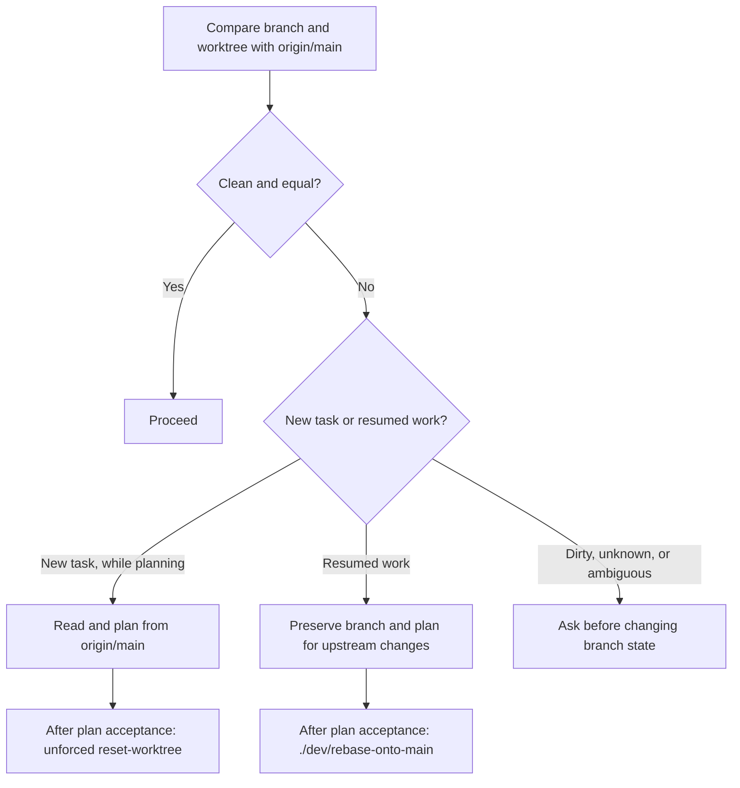

# Getting Started

How to run all services locally and load the site in a browser.

Agent workflow policy lives in [AGENTS.md](../../AGENTS.md); the
[local-site-testing skill](../../.agents/skills/local-site-testing/SKILL.md) is the concise agent
guide for full-site startup and browser validation. Cross-repository issue mutations follow the
[public repository issue-routing decision](public-repository-issue-routing.md).

Development owner indexes: [CI](ci/README.md), [harness setup](harnesses/README.md),
[PostgreSQL](postgresql/README.md), [Valkey](valkey/README.md), and
[static analysis](quality/static-code-analysis/README.md).

## Prerequisites

- macOS, or glibc-based Linux on x64 or ARM64 (musl such as Alpine is unsupported); Node.js matching `.nvmrc`.
- For the full web stack and Playwright: Docker Desktop (Valkey with Bloom, JSON, Search modules),
  PostgreSQL with UUIDv7 support, and tmux.
- Claude Code, Codex, Grok, Cursor, and OpenCode CLIs are optional; see
  [agent-harness parity](agent-harness-parity.md) and the [harness setup index](harnesses/README.md).

Provision host dependencies with
[vouchington-machines](https://github.com/vouchington/vouchington-machines), run its
`./configure-agents.sh` for agent sandbox, approval, and model config, then use Voucha's initializer
for checkout-owned dependencies and services. [system-dependencies.md](system-dependencies.md)
states the ownership boundary and required host capabilities.

## Quick Start

```bash
git clone git@github.com:vouchington/vouchington.git && cd vouchington
./dev/initialize monorepo   # lint / unit tests only: deps and pinned tooling, no Docker or DB
./dev/initialize backend    # adds DB, Valkey container, migrations, .env for DB/Valkey-backed tests
./dev/initialize            # full web stack (alias for web)
./dev/tmux                  # one managed session with five service windows
```

Open the Cloudflare Worker URL (`https://localhost:8787` on main) for browser-grade validation. If
`./dev/tmux` prints an `http://` URL, local mkcert certs are missing: use it only as a process
liveness fallback, then install or regenerate certs. Initialization is safe to re-run; it reuses saved
ports and resources for the current worktree identity. Test commands are in [tests.md](tests.md), and
`source .env` first.

Traffic flows Browser → CF Worker → Next.js (pages), Backend (`/api/*`), and Lambdas (image resizing,
browser crawl).

`.initialized` records the strongest completed capability (`monorepo` < `backend` < `web`), not the
latest requested mode, and `./dev/reset-worktree` is the intentional invalidation boundary; see
[Initialization Modes](local-development/reference-initialization-modes.md). No shared secrets are
required to start the app; `~/voucha.env` is optional ([local-env-vars.md](local-env-vars.md)).
Command contracts are in each `dev/` script's usage text.

## Working on a Parallel Branch

Use git worktrees; each gets its own ports, database, and Valkey container. Non-main database and
Valkey names hash the canonical physical worktree root, not the branch or directory name, so moving a
checkout changes its identity: rerun `./dev/initialize web`, then `./dev/cleanup` removes orphaned
resources ([Cleanup](local-development/reference-cleanup.md)). Agent-created temporary or subagent
worktrees go under the OS tmpdir per
[Start Of Work](../../.agents/skills/agent-workflow/start-of-work.md). Run `./dev/tmux` from outside
tmux. See [dev/AGENTS.md](../../dev/AGENTS.md) for worktree documentation.

### Fresh-base planning

The `./dev/check-fresh-base` session hook fetches `origin/main` and compares it with the current
branch before an agent plans or implements work. If the fetch fails or `origin/main` is missing,
freshness is unknown and the agent must retry before trusting the checkout.



Plan Mode is read-only with respect to branch history: inspect `origin/main` with `git diff` and
`git show` instead of resetting or rebasing during planning. Once the plan is accepted, use unforced
`./dev/reset-worktree` for a new task planned from `origin/main`, or preserve the branch and run
`./dev/rebase-onto-main` for resumed work, after reading the four refs in
[Reading the four refs](../../.agents/skills/agent-workflow/git-and-prs.md#reading-the-four-refs) so a
rewritten `origin/<branch>` is not replayed onto local `main`. Never infer permission to discard
changes or add `--force`. The procedure lives in
[Start Of Work](../../.agents/skills/agent-workflow/start-of-work.md); the hook roster is in
[Agent Session Hooks](local-development/README.md#agent-session-hooks).

## Troubleshooting

- **Migrations fail after rebase:** follow [Ephemeral worktree databases](../../AGENTS.md), then
  `source .env && pnpm run db:clean && pnpm run db:migrate`.
- **Missing dependencies after rebase:** `pnpm install`, then `pnpm run syncpack:lint && pnpm run no-mistakes`.
- **Views can't be replaced with `CREATE OR REPLACE`:** `pnpm --dir backend db:migrate -- --forced`
  drops all managed views first and recreates them from `backend/data-stores/psql/views/`.
- **`index.lock`, a stuck rebase, or `another ./dev/reset-worktree is running`:** see
  [git-worktree-locks.md](git-worktree-locks.md).

## Dependency Updates

Dependabot (npm/docker/github-actions) and Renovate (`.nvmrc` and regex-managed version literals)
jointly keep dependencies fresh. pnpm itself is not pinned; CI and Docker builds name only a pnpm
major. See [dependency-updates.md](dependency-updates.md) for the policy and how to add a new pinned
binary.

## Reference index

- [Test Helpers](../../backend/test-helpers/README.md)
- [API Fixtures](../../backend/test-helpers/api-fixtures/README.md)
- [Harness Engineering — Agent Observability](harness-engineering.md)
- [Merge Authority](merge-authority.md)
- [OpenTelemetry — Local Tracing](opentelemetry.md)
- [Adding a Trusted/Credentialed CI Job](reference-ci-adding-a-trusted-credentialed-ci-job.md)
- [CI Job Conditions](reference-ci-ci-job-conditions.md)
- [Destructive Manual Workflows](reference-ci-destructive-manual-workflows.md)
- [Adding a new pinned binary](reference-dependency-updates-adding-a-new-pinned-binary.md)
- [Frozen-install policy](reference-dependency-updates-frozen-install-policy.md)
- [Manually maintained pins](reference-dependency-updates-manually-maintained-pins.md)
- [Supply-chain policy](reference-dependency-updates-supply-chain-policy.md)
- [DynamicConfig Cleanup](reference-dynamicconfig-cleanup.md)
- [Explain Test Selection and Vitest Ownership](reference-explain-test-selection-and-vitest-ownership.md)
- [Decision flow](reference-merge-authority-decision-flow.md)
- [Why "automation" means GitHub Actions](reference-merge-authority-why-automation-means-github-actions.md)
- [E2E and Visual](reference-tests-e2e-and-visual.md)
- [Local Web Validation Recovery](reference-tests-local-web-validation-recovery.md)
- [Schema Checks](reference-tests-schema-checks.md)
- [Storybook A11y Exceptions](reference-tests-storybook-a11y-exceptions.md)
- [Test Value and Safe Reduction](reference-tests-value-and-reduction.md)
- [Vitest Mock Typing](reference-tests-vitest-mock-typing.md)
- [Vitest Projects](reference-tests-vitest-projects.md)
- [Glide-MQ Testing with TestQueue and TestWorker](testing/backend/glide-mq-testing.md)
- [Translation catalog and locale checks](reference-tests-translation-catalog-and-locale-checks.md)
- [Public post eligibility](../overview/architecture/reference-post-lifecycle-public-eligibility.md)
