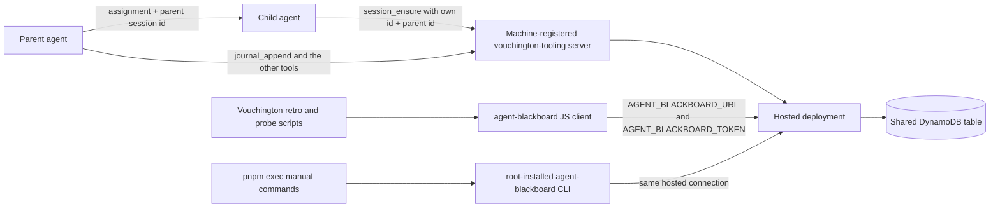

# Agent Blackboard — Hosted Session Store

Durable storage for [`agent-blackboard`](https://github.com/jonathanong/agent-blackboard), the
published client and CLI behind agent session journaling. Agents reach it through the
`vouchington-tooling` MCP server, which
[vouchington-machines](https://github.com/vouchington/vouchington-machines/blob/main/docs/agent-config.md)
registers once per machine in every harness; no repository file registers a server. Vouchington
connects to a **hosted deployment**; there is no local server or database. What gets written into
sessions belongs to the [`blackboard` skill](../../.agents/skills/blackboard/SKILL.md).

## Architecture

Every process with the hosted connection uses the same durable store; there is no local/CI split.
The Lambda and DynamoDB infrastructure live in the separate `agent-blackboard` repository, which
owns redeploying, scaling, and repair.

## Setup (human runbook)

1. Run vouchington-machines' `./configure-agents.sh`, then `./diagnose-agents.sh --repo <worktree>`.
   See [harness parity](agent-harness-parity.md#capability-matrix).
2. Run `pnpm install` for the root-installed client and CLI (the MCP server does not depend on it).
3. Export `AGENT_BLACKBOARD_URL` and `AGENT_BLACKBOARD_TOKEN`. Both are required; there is no
   token-file or local-server fallback. Mint a credential with
   `pnpm exec agent-blackboard credentials create --name <name>-local` (needs the deployment's admin
   token). The raw token prints once and the server stores only its hash; keep it in a shell profile
   or secrets manager, never on disk in this repository.

Manual CLI commands are for people inspecting a session. An agent journals through the MCP
`journal_append` tool. Sandboxed Claude and Codex commands never receive the credential; see the
[sandbox credential deny list](agent-sandbox.md#sandbox-credential-deny-list).

## Automated sessions

An automated session may not have the server: no repository registers it, and nothing here checks
for it. A missing server does not stop a run. The run continues its primary work and states in its
final report that journaling was unavailable and why, any pending outbox state, and the findings it
would have journaled.

## Retrospectives and distillation

Retrospective persistence goes through `retrospective_check` and `retrospective_save`, never
`journal_append`: `retrospective_save` runs the repository policy module `dev/agent-policy.mts` in
a credential-free child process, and `journal_append` would bypass those repository-owned
invariants. Distillation reads the bulk export from `snapshot_export` and archives per session;
eligibility and redaction rules live in the
[retrospective-distill skill](../../.agents/skills/retrospective-distill/SKILL.md). Before any
export or `session_archive`, the root drains every worktree's outbox, because an archived session
refuses later delivery and would strand a retained record.

## Session start and availability

No hook starts a session. An agent's first `session_ensure` or `journal_append` call creates it on
demand through the machine-registered MCP server. An agent finds out whether a harness connected the server by searching for
`journal_append`. If tooling has not been initialized, run `./dev/initialize monorepo` from the
worktree root. Until the server is available, use the harness session id as the
[blackboard skill](../../.agents/skills/blackboard/SKILL.md) directs.
