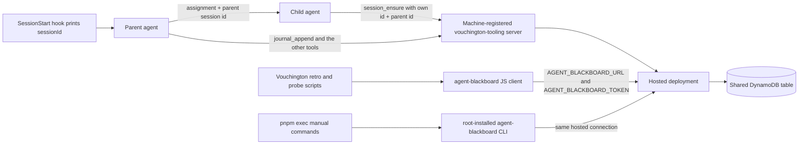

# Agent Blackboard — Hosted Session Store

Durable storage for [`agent-blackboard`](https://github.com/jonathanong/agent-blackboard), the
published client and CLI behind agent session journaling. Agents reach it through the
`vouchington-tooling` MCP server, which
[vouchington-machines](https://github.com/vouchington/vouchington-machines/blob/main/docs/agent-config.md)
registers once per machine in every harness; no repository file registers a server. Vouchington
connects to a **hosted deployment**; there is no local server or database. What gets written into
sessions belongs to the [`blackboard` skill](../../.agents/skills/blackboard/SKILL.md).

## Architecture

Every process with the hosted connection uses the same durable store; there is no local/CI split.
The Lambda and DynamoDB infrastructure live in the separate `agent-blackboard` repository, which
owns redeploying, scaling, and repair. The Bash gates never see MCP calls, so no `PreToolUse`
matcher covers `mcp__` tools.

## Setup (human runbook)

1. Run vouchington-machines' `./configure-agents.sh`, then `./diagnose-agents.sh --repo <worktree>`.
   See [harness parity](agent-harness-parity.md#capability-matrix).
2. Run `pnpm install` for the root-installed client and CLI (the MCP server does not depend on it).
3. Export `AGENT_BLACKBOARD_URL` and `AGENT_BLACKBOARD_TOKEN`. Both are required; there is no
   token-file or local-server fallback. Mint a credential with
   `pnpm exec agent-blackboard credentials create --name <name>-local` (needs the deployment's admin
   token). The raw token prints once and the server stores only its hash; keep it in a shell profile
   or secrets manager, never on disk in this repository.

Manual CLI commands are for people inspecting a session. An agent journals through the MCP
`journal_append` tool. Sandboxed Claude and Codex commands never receive the credential; see the
[sandbox credential deny list](agent-sandbox.md#sandbox-credential-deny-list).

## Automated sessions

An automated session may not have the server: no repository registers it, and nothing here checks
for it. A missing server does not stop a run. The run continues its primary work and states in its
final report that journaling was unavailable and why, any pending outbox state, and the findings it
would have journaled.

The published Harness dispatch workflow does not provision `AGENT_BLACKBOARD_URL` or
`AGENT_BLACKBOARD_TOKEN`; agent-blackboard is orthogonal to Auto Harness.

## Retrospectives and distillation

Retrospective persistence goes through `retrospective_check` and `retrospective_save`, never
`journal_append`: `retrospective_save` runs the repository policy module `dev/agent-policy.mts` in
a credential-free child process, and `journal_append` would bypass those repository-owned
invariants. Distillation reads the bulk export from `snapshot_export` and archives per session;
eligibility and redaction rules live in the
[retrospective-distill skill](../../.agents/skills/retrospective-distill/SKILL.md). Before any
export or `session_archive`, the root drains every worktree's outbox, because an archived session
refuses later delivery and would strand a retained record.

## SessionStart availability check

The hook runs `vouchington agent-blackboard session-start` at every SessionStart. If tooling has not
been initialized, or the installed CLI lacks this command, it gives a fixed setup advisory; run
`./dev/initialize monorepo` from the worktree root. Until then, use the harness session id as the
[blackboard skill](../../.agents/skills/blackboard/SKILL.md) directs. Once available, the CLI
prints the `Blackboard sessionId:` line from the hook's own payload (no inherited environment or
persisted file can leak in) and probes the hosted deployment, asking the user to fix a missing
credential or unreachable service. In a sandbox it skips the probe and reports the withheld
credential and egress instead of a false outage. It cannot see whether a harness connected the MCP
server; an agent finds out by searching for `journal_append`.
