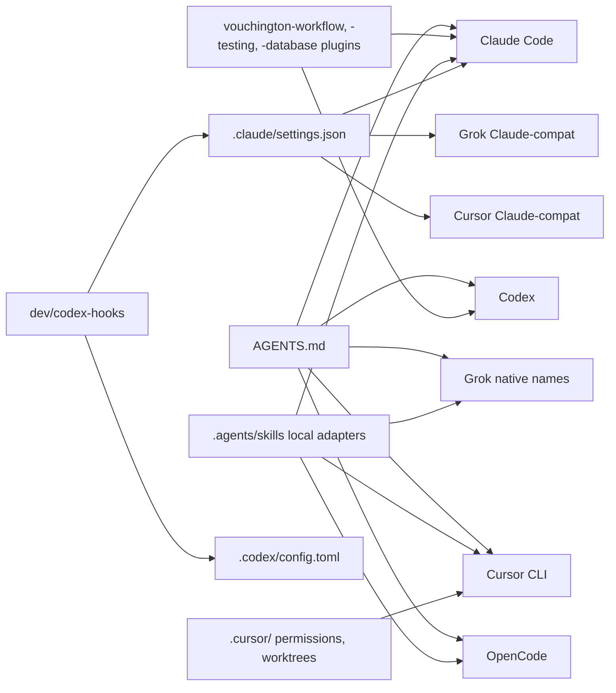

# Agent Harness Parity — Claude, Codex, Grok, Cursor, and OpenCode

Local coding agents in this repository share one instruction source and one policy runner.
`.claude/settings.json` is the only hook source for Claude, Cursor, and Grok; `.codex/config.toml`
is Codex's. Grok does not get a copied `.grok/hooks`, `.grok/skills`, or permission allowlist, and
Cursor does not get a `.cursor/hooks.json`: both run the Claude hooks through Claude-compat. Each
harness's setup quirks live in its [harness page](harnesses/README.md); sandbox and approval policy
live in [Agent Sandbox](agent-sandbox.md).

Codex worktrees need dependencies before a chat starts because repository hooks import workspace
packages. The [local environment](../../.codex/environments/environment.toml) owns that bootstrap;
putting installation in a session hook would let other startup hooks race it. Select this environment
when creating a worktree in the desktop app; see [Codex local environments](https://learn.chatgpt.com/docs/environments/local-environment).

## Instruction loading

- Codex assembles `AGENTS.md` from the repository root through its startup working directory.
  Starting at the root does not load every nested file. Read each target path's instruction ancestry
  explicitly before editing.
- Claude Code loads native `AGENTS.md` with ancestor and lazily read subtree instructions. A
  `CLAUDE.md` shadows `AGENTS.md` in the same directory, so keep it gitignored, and automatic
  discovery skips `.agents`; explicitly read [skill instructions](../../.agents/skills/AGENTS.md).
- Prefer the local adapter before the canonical plugin. Canonical `nextjs-vitest-test-authoring`
  maps to local `web-vitest-test-authoring`; other adapter names match their canonical name.
- Installation prerequisite closure makes resources available; it does not require reading every
  installed skill. Load the current phase and relevant authoring procedure only.

## Reusable domain skills

Local adapters under `.agents/skills` are overlays, not standalone workflows; the current list is
in [`.agents/catalog/README.md`](../../.agents/catalog/README.md) and its bijection with
`.claude/skills` is enforced by `finite-set-consistency` (`.no-mistakes.yml`). Claude Code and Codex
load each canonical source from the `vouchington-workflow`, `vouchington-testing`, or
`vouchington-database` plugin; Grok, Cursor, and OpenCode load it from
`node_modules/vouchington-tooling/skills/<name>/SKILL.md`. Every adapter stops if its harness's
canonical source cannot be read; it must never apply its Vouchington overlay alone. No repository
registers an MCP server, plugin, or marketplace;
[vouchington-machines](https://github.com/vouchington/vouchington-machines/blob/main/docs/agent-config.md)
registers them per machine. Upstream-only skills (`dotnet-test-authoring`, `swift-test-authoring`,
`github-actions-authoring`, `npm-publishing`, `test-authoring`) deliberately have no local adapter.

## Capability matrix

| Capability    | Claude                                                       | Codex                                                         | Grok                                                              |
| ------------- | ------------------------------------------------------------ | ------------------------------------------------------------- | ----------------------------------------------------------------- |
| Instructions  | Nested `AGENTS.md`; `CLAUDE.md` is gitignored                | Nested `AGENTS.md`; no `project_doc_fallback_filenames`       | Nested `AGENTS.md`; do not add `CLAUDE.md`                        |
| Skills        | Domain plugin + `.claude/skills` → `.agents/skills` overlays | Domain plugin + Skill tool / local overlays                   | `.agents/skills` overlays load installed Vouchington skills       |
| Hooks         | `.claude/settings.json`                                      | `.codex/config.toml`                                          | Claude hooks via compat; the PreToolUse command sets a `timeout`  |
| Permissions   | `.claude/settings.json` allow/deny                           | `.codex/rules/default.rules`                                  | Claude permission strings via compat                              |
| Sandbox       | User's config; only `dev/` script exclusions in the project  | User's config; allow prefixes run outside it without a prompt | User's config: off, because a sandboxed Grok cannot escalate `gh` |
| MCP           | Registered per machine; no repository file                   | Registered per machine; every tool pre-approved               | Imports Claude's machine registration                             |
| Session id    | `CLAUDE_CODE_SESSION_ID`                                     | `CODEX_THREAD_ID`                                             | Shell and hook `GROK_SESSION_ID`                                  |
| Merge confirm | Silent allow for one plain merge when attended               | Empty hook output (best-effort)                               | Empty confirm (best-effort)                                       |
| Folder trust  | Always loads project settings                                | Loads project hooks                                           | Project Claude hooks need `/hooks-trust`                          |
| CI            | Local agent only                                             | Scheduled / dispatch / shepherd                               | Out of scope while CI is being redone                             |

Ambient Blackboard identity is owned by
`agent-blackboard`; transcript discovery
uses `resolveTranscriptFile` from `vouchington-tooling/retrospective-transcript`.

## How Grok reuses Claude rules

Grok's Claude-compat loader already reads this repo's `.claude/settings.json` hooks and permissions.
Do not copy those files into `.grok/`: a second hook source would double-fire.

Grok prefix-matches Claude `permissions.deny` strings with no word boundary, so a deny must not be a
prefix of a sanctioned command: `Bash(git push --force)` matches `git push --force-with-lease`.
Plain force pushes stay out of the deny list for that reason. `.husky/pre-push` rejects `--force`,
`-f`, and a `+` refspec and allows `--force-with-lease`; the PreToolUse hook blocks the same push
for harness agents. `dev/claude-settings-grok-bash-deny.test.mts` locks the deny-list absence.

The shared runner reads Grok's hook dialect (payload field names, `Hook denied: <reason>`, `deny`
rather than `block` in stdout JSON, a fail-open default timeout) and lists both Claude and
Grok tool names in the PreToolUse matcher so the policy fires even if name aliases are off.

## Cursor through Claude-compat

Cursor CLI runs the `.claude/settings.json` hooks through its Claude-compat loader, like Grok. Do
not add `.cursor/hooks.json`: Cursor loads it as well, so every hook would double-fire.
`dev/agent-sandbox-config.test.mts` fails if it (or `.grok/hooks/`) comes back. Cursor's agent
shell has no session-id env, and Grok's exports `GROK_SESSION_ID`. Hooks fail
open on a crash or timeout; accepted, because the hook is a mistake guardrail, not a security
boundary. Without `.cursor/hooks.json`, Cursor never fires `UserPromptSubmit`, so it gets no tmux
nudge on prompt submit.

## Privacy

Cursor, Codex, Claude Code, Grok, and OpenCode are permitted only with coding-data and training
opt-out enabled; Grok uses `/privacy`. Gemini and Z.AI remain unapproved.

Shared skills and agents reach every harness through the vouchington-workflow plugin, the
vouchington-testing plugin, and the vouchington-database plugin, so no per-harness copy exists.
