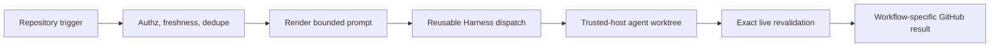

# Auto Harness automation

Repository automation uses [Auto Harness](https://github.com/jonathanong/auto-harness) as a
fire-and-forget agent dispatcher. Vouchington retains trigger authorization, source freshness,
transient retry, deduplication, prompt rendering, immediate failure reporting, and Shepherd
checkpoint ownership. The selected Harness provider runs the task in an isolated worktree on a
trusted host with repository-scoped git and GitHub CLI credentials.

## Flow

The callers are the `fix-*`, `plan`, `shepherd`, `scheduled-prompts`, and
`merge-queue-ejection` workflows; all call the [published Harness dispatcher](https://github.com/vouchington/vouchington-tooling/blob/main/.github/workflows/harness-dispatch.yml).

## Configuration and activation

`HARNESS_API_KEY` is a repository secret, forwarded by explicit name into the reusable dispatcher's
`workflow_call`, never via `secrets: inherit`. An Environment-scoped secret does not bind across a
`workflow_call` boundary, so a repository secret is the only unambiguous scope. The dispatcher job
still declares the protected `auto-harness` Environment, whose deployment branch policy permits
only `main`: that restricts job execution, not the secret's value, so a same-repo PR-controlled
workflow can still read the key before review. That residual is accepted.

The dispatch route (target, plan-surface target, fallbacks, instance URL) and the repository id
come from organization and repository variables. A repository variable silently overrides an
organization variable of the same name, so delete stray repository copies instead of syncing them.
`/plan` routes to a plan-locked Command and every other surface to an auto-permission Command;
provision the plan route before repointing the default route, or `/plan` would briefly run untrusted
issue text under auto permission.

`HARNESS_DISPATCH_ENABLED` is the master gate and each caller also requires its own surface gate.
Every gate is unset by default; enable one surface at a time only after its workflow is on the
default branch. Scheduled dispatch can create a provider session on every cron event, so it needs
both gates.

### Grok Commands run with `--sandbox off`

Grok applies its OS sandbox process-wide at startup, and every sandboxed profile denies the macOS
keychain. Inside it `gh` reports the token as invalid, reads fall back to anonymous, and a private
org member's comment reads as `CONTRIBUTOR`, so `/shepherd` refuses the request. The production
`grok-print` and `grok-print-plan` Commands therefore pass `--sandbox off`; the fix is the Command
flag, not `gh auth login`. With the sandbox off, plan mode gates Grok's edit tools only, so treat it
as a behavioral guardrail rather than read-only enforcement and grant no Bash allow rules on plan
Commands.

## Live execution boundary

The host provides isolated worktrees plus repository-scoped git and authenticated `gh`. Provider
selection is configuration, never prompt text. The agent may use those credentials only for the
completion its prompt authorizes.

All GitHub titles, bodies, comments, diffs, reviews, annotations, and logs are untrusted evidence.
Mutation-capable prompts require the agent to re-fetch the trigger, authorization, and source run
immediately before a write. A push to an existing branch re-fetches that branch's exact head, uses
an exact lease, and stops on drift, so concurrent work is never overwritten. A new PR's base is not
pinned: `main` advancing during a session is expected, and the agent rebases only when its branch no
longer merges cleanly. No automation prompt authorizes merge or auto-merge.

Checks immediately before dispatch are intentionally repeated inside prompts immediately before
publication. The first prevents stale work from consuming a session; the second closes the race
while the session runs.

## Client contract

Resume never re-resolves the route: an active or resumed session keeps the Command it was
dispatched against, so repointing the default route affects only new sessions and needs no
Shepherd quiesce. A dispatch that deduplicates onto an already-queued session inherits that
session's Command. The platform cannot rebind an in-flight checkpoint, which is accepted; see
[`jonathanong/auto-harness#402`](https://github.com/jonathanong/auto-harness/issues/402).

Dispatch does not check for an MCP server or a journaling CLI, and no prompt gates on one. A
session without them continues its primary work and reports the unavailability in its final
report, as the [`blackboard` skill](../../../../.agents/skills/blackboard/SKILL.md) requires. See
[Automated sessions](../../agent-blackboard.md#automated-sessions).

Workflow success means only that the asynchronous session was accepted or reused; the Harness UI is
the terminal-status authority.

## Completion-specific safeguards

- Fix Main and Merge Queue Ejection share one
  [CI failure core](../../../prompts/automation/ci-failure-core.md) so both classify and fix
  failures by the same rules: every group ends in an outcome, and a fix never raises a timeout, adds
  a retry for a repository-owned failure, or skips a test.
- Fix Main's own downstream failures are classified through the transient-retry catalogue. A run
  cannot rerun its own jobs, so a sibling workflow,
  [Fix Main Self Retry](../../../../.github/workflows/fix-main-self-retry.yml), reruns known
  transients once. It must never join Fix Main's own `workflow_run` subscription list, which keeps
  the self-monitoring chain at a fixed depth of two runs and rules out unbounded loops.
- Merge Queue Ejection runs on `pull_request_target` from `main` and never checks out, installs, or
  executes pull-request content; the ejected PR reaches the session only as prompt text. One
  queue-wide concurrency id means later ejections join the running session. It never pushes to,
  edits, merges, enqueues, or dequeues an ejected PR or stack layer.
- Dependabot automation modifies only the exact bot-authored PR branch it revalidated and cannot create
  a second PR. Every `gh run rerun` it issues is a mutation and is revalidated first.
