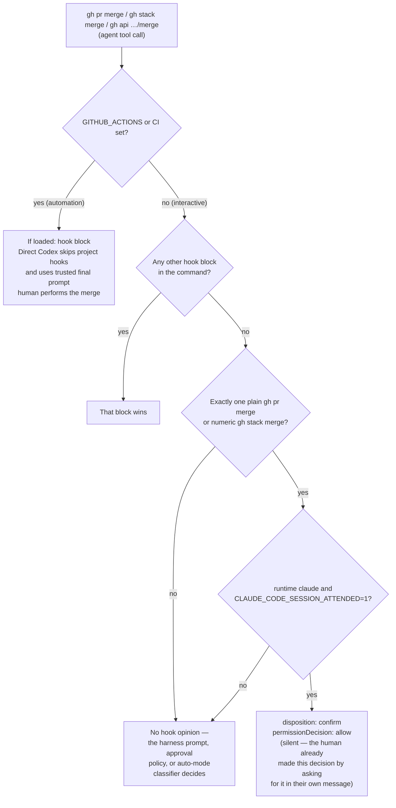

# Decision flow

[Back to Merge Authority](merge-authority.md#decision-flow)

Automation blocks any command that names `gh` or `gh-stack` together with a merge: a `merge` word
(`gh pr merge ...`, `gh stack merge ...`), a `/merge` or `/merges` API path, or the GraphQL
`enablePullRequestAutoMerge`/`mergePullRequest` mutations. The check is coarse on purpose. It reads
the same scripts, substitutions, and heredocs as the other gh rules but parses no wrappers or
spellings, so it also blocks `git merge` beside `gh`, merge `--help`, and prose naming
`gh pr merge`. It misses obfuscated or indirect forms, such as a variable or alias that supplies
`gh` or the action (`$GH pr merge 1`), a mutation read from a file
(`gh api graphql -F query=@file`), or a heredoc script behind an unmodeled wrapper
(`timeout 5 bash <<'EOF'`); see the [hook threat model](agent-sandbox.md#hook-threat-model).
Interactively, only a lone `gh pr merge` or numeric `gh stack merge` in an attended Claude session
gets the silent allow. Every other interactive merge gets no hook opinion. Cursor and Grok run the
same Claude-compat hook but resolve as their own runtimes, so a lone merge there gets no hook
opinion even when they inherit `CLAUDE_CODE_SESSION_ATTENDED=1`. Every other hook policy
(force-push, `--amend`, dev-server launches, hook-bypass flags, and native stack workflow controls)
is unrelated to merge authority and blocks the same way in
automation and interactive sessions, and those blocks win over the merge allow. PR body validation,
provenance, and Shepherd Journal preservation live in the structured `pr_create` and `pr_update` MCP
tools and do not affect the merge decision. See the [Codex hook policy](../../.agents/skills/agent-workflow/git-and-prs.md).

**Confirm strength differs by runtime.** Claude's `permissionDecision: "allow"` proceeds silently no
matter what auto-mode is active, so the hook emits it only for an attended session. An unattended
Claude session (`claude -p`) gets empty output, and its permission mode decides. Codex's confirm
relies on the machine's Codex `approval_policy = "on-request"` (user config written by
vouchington-machines, see [agent-sandbox.md](agent-sandbox.md)). A Codex session explicitly
started with `--ask-for-approval never` or `--dangerously-bypass-approvals-and-sandbox` has opted
out of that, and the hook has no Codex-side
equivalent to force a prompt either way. Interactive Codex merge may still surface a confirmation,
but that confirmation is inherited from session config, not guaranteed by the hook.

**Scope note:** this hook governs merges issued as **agent tool calls**. It does not touch
workflow-initiated merges. Dependency-bot auto-merge is disabled in this repository; see the
[dependency update merge policy](dependency-updates.md#review-and-merge).

**What stays unconditional:** automation (`GITHUB_ACTIONS`/`CI` set) hard-blocks every merge shape
regardless of runtime, with no path back to `allow`. `findAutomationMergeBlock` returns
`disposition: 'block'` directly, and `findInteractiveMergeConfirm` never returns a confirm under
automation. What
changed is the interactive side: the human decision that authorizes a merge is the human asking for
it in their own message, not a second tool-level popup. So a lone merge in an attended Claude
session renders as an immediate, silent `allow` instead of a forced prompt.
