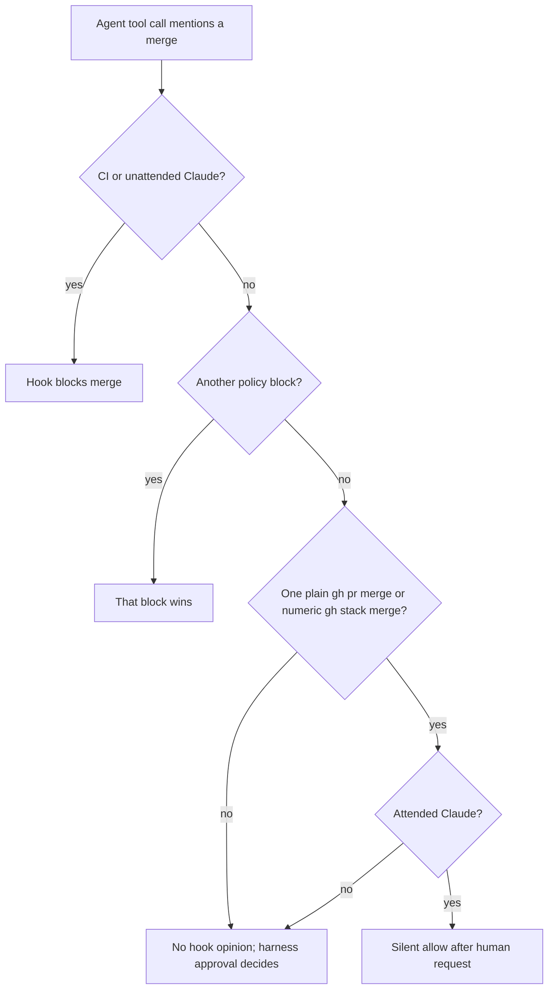

# Decision flow

[Back to Merge Authority](merge-authority.md#decision-flow)

The automation check is intentionally coarse: a command that names `gh` or `gh-stack` with a merge
word or API mutation is blocked, even if the text only describes a merge. It reads the same scripts,
substitutions, and heredocs as the other GitHub rules. Indirect commands that the hook cannot see
remain outside its [threat model](agent-sandbox.md#hook-threat-model).

The silent allow applies only to a lone merge in an attended Claude session. Cursor and Grok use
Claude-compatible hook configuration but resolve as their own runtimes. Codex and compound commands
receive no interactive allow; their harness approval policy decides. A separate policy block, such
as force push or hook bypass, takes precedence over the allow. PR body validation, provenance, and
Shepherd Journal preservation live in the structured `pr_create` and `pr_update` MCP tools.

The hook governs agent tool calls, not workflow-initiated merges. Direct Codex routes that do not
load project hooks rely on their trusted final prompt and the human to perform the merge. The
human's merge request is the authority for an attended Claude command; its silent allow removes a
second tool-level prompt only after that request.
