# Feeds

Personalized post and RSS feed item feeds for logged-in users. Feeds are filtered by the user's follow graph, mute/block lists, and vote scores. Posts support both chronological (`sort=new`) and trending (`sort=hot`) ordering.

## Query Pipeline

Both feeds combine direct and shared deliveries with the viewer's follow and exclusion relations. Personalized RSS reads the recent publication window in one SQL statement. Followed sources and topics are indexed membership filters, combined as a union. Eligibility, score thresholds, search, media and related-post filters are conditions on each ordered item walk. Direct and shared walks each stop after a page and its lookahead, then merge in delivery order. Selective filters can inspect the publication window without exposing an empty continuation page.

The item publication window bounds the RSS read instead of a candidate budget. Longer requested ranges use the personal feed's maximum horizon; narrower ranges remain narrower. Direct items use their publication tuple, while shares retain their independent delivery tuple and metadata. Both the target item and the share delivery must fit the requested horizon. Live item, follow or score changes can change results between requests.

```mermaid
flowchart TD
    subgraph Posts["Post feed - getPostFeedIds (sort=new default, or hot)"]
        PR["Relation CTEs: followed_users/topics, excluded_users/topics, hidden_posts, excluded_hostname_ids"] --> PE
        PE["eligible_posts CTE: visibility, mute/block, hostname block, post_type, search filters"] --> PDirect
        PDirect["direct_candidate_posts -> direct_posts (follow-match via followed_users/topics)"] --> PCombined
        PR --> PTargets
        PTargets["Enabled shares: recipient deliveries -> distinct target IDs"] --> PEligibleTargets
        PEligibleTargets["Indexed target/root probes using the same eligibility builder"] --> PShared
        PShared["shared_posts: eligible targets rejoin separate delivery events"] --> PCombined
        PCombined["combined_posts = direct_posts UNION ALL shared_posts"] --> PSort
        PSort{"sort=hot or sort=new?"}
        PSort -- hot --> PHot["ORDER BY hot_score DESC"]
        PSort -- new --> PNew["ORDER BY sort_at DESC"]
        PHot --> PCursor
        PNew --> PCursor
        PCursor["LIMIT+1 -> page_info (opaque cursor: score|timestamp + id)"]
    end

    subgraph RSS["RSS item feed - getRssFeedItemFeedIds"]
        RR["Follow and exclusion relations"] --> RM
        RR --> RE
        RM["Cursor-relative RSS item walk with indexed source OR topic membership"] --> RD
        RD["Visibility, score, search, media and related-post filters"] --> RW
        RW["Indexed check for a newer matching story member, then ordered page + lookahead"] --> RCombined
        RE["Eligible recent recipient shares, ordered page + lookahead"] --> RCombined
        RCombined["Direct and shared deliveries = UNION ALL"] --> RFinal
        RFinal["Delivery order -> page + lookahead"]
    end
```



## Feed Types

| Entity Type    | Feed Type          | Description                                                                                                                                                      |
| -------------- | ------------------ | ---------------------------------------------------------------------------------------------------------------------------------------------------------------- |
| Posts          | `follow_users`     | Posts by users the current user follows                                                                                                                          |
| Posts          | `follow_topics`    | Posts with a related topic the current user follows (`votes_score_net > 0` on the category relation; vote-stats recompute is async after `upsertEntityRelation`) |
| Posts          | `any`              | Union of the above (default)                                                                                                                                     |
| Posts          | `all`              | Intersection: must match both follow_users and follow_topics                                                                                                     |
| RSS Feed Items | `follow_rss_feeds` | Items from RSS feeds the current user follows                                                                                                                    |
| RSS Feed Items | `follow_topics`    | Items with a category/related topic the current user follows                                                                                                     |
| RSS Feed Items | `any`              | Union of the above (default)                                                                                                                                     |
| RSS Feed Items | `all`              | Union of the above                                                                                                                                               |

## Filtering

- **Post types**: Filter by discussion, review, article, etc. The default feed excludes `article`, `comment`, and `topic_recommendation` post types. Articles are staff-created content and do not appear in user feeds by default — they are browsable at `/articles`. Comments only show from followed users.
- **Minimum vote score**: Separate thresholds per source (e.g. `min_score_follow_users` defaults to -5, `min_score_follow_topics` defaults to 0).
- **Time range**: Personalized RSS applies its maximum recent-publication horizon to longer selections; a shorter selection stays shorter. Post feeds retain their own time-range semantics.
- **Privacy**: `buildViewerPostDiscoveryEligibilityFilter` applies canonical candidate/root eligibility plus discovery-only archived-content and suspended-author exclusions.
- **Hidden content**: Posts/items related to muted or blocked topics, users, or RSS feeds are excluded.
- **RSS-specific**: `appendRssFeedItemEligibilityFilters` owns the shared item predicate for direct and shared delivery paths: nondeleted item, at least one active/nondeleted source that is not muted or publisher-topic-excluded, hidden/topic/hostname exclusions, related-post, media, text, source-topic, and hashtag filters. A `topic_ids` source match itself must be active and nondeleted, so an item with an unrelated active source cannot pass through a disabled or deleted matching source. This intentionally does not require global discoverability: users can still receive items from feeds they follow when those feeds are hidden from public discovery. `has_related_posts` shows only items with/without linked discussion posts.
- **Community scope**: Authenticated News Feed and Posts Feed pages accept a `community` query
  parameter. For Posts Feed, the community's active topic list replaces the viewer's followed topic
  scope. For News Feed, the community's active RSS feed and topic lists replace the viewer's followed
  source/topic scope. The dropdown is populated from communities the viewer is an active member of
  or proxy-follows and only includes communities that can source the selected feed.
- **RSS suppression (global feed only)**: Items whose every source feed is globally suppressed — either by admin flag or because the owning topic's `votes_score_net` is below the global threshold — are hidden from the global feed. Personal feeds are **not** filtered this way: users who follow a suppressed feed still see items in their personal feed. See Admin Suppression for threshold configuration.

## Share Actions

Users can share posts or RSS feed items with their followers. Share requests persist a bounded follower-distribution intent and workers fan it out in chunks to `post_feed_shares` and `rss_feed_item_feed_shares`. Only public, broadly-visible posts can be shared, users cannot share their own posts, and shared post deliveries still respect the post's current broadcast audience if the creator later tightens visibility.

Post feeds include share delivery only for `follow_users` and `any`; `follow_topics` and `all`
omit the share CTEs and union arm. Enabled shares first materialize recipient deliveries after
sharer exclusions, delivery-time cutoff, and chronological cursor filtering. Distinct target IDs
then drive indexed post/root eligibility probes through the same
[eligibility SELECT builder](../../../backend/services/feeds/posts/get-ids/eligible-posts-cte.mts)
used by direct posts. The lateral lookup returns at most the one row identified by the post's
primary key, keeping eligibility work bounded without materializing the broad direct cohort.
Eligible targets rejoin their deliveries, so repeated shares and a direct delivery of the same
post remain separate events. Hot pagination applies the final score/delivery-ID boundary and
does not push a timestamp cursor into share candidates. An old post can appear through a recent
share because the share cutoff uses delivery time rather than target creation time.

## Post Feed Sort Options

- `sort=new` (default) — chronological descending. Cursor encodes `{ timestamp: number, id: string }`.
- `sort=hot` — exponential time-decay ranking with a half-life. Higher-scored recent posts rank above older high-score posts. Cursor encodes `{ score: number, id: string }`. Search, feeds, and trending posts share the canonical hot-score builder, including its future-timestamp handling.

## Pagination

Cursor-based pagination with opaque base64-encoded cursors (industry standard: GraphQL Relay, GitHub API, Stripe).

- Cursor structure varies by sort: `{ timestamp: number, id: string }` for `sort=new`, `{ score: number, id: string }` for `sort=hot`
- Use `after` parameter with `page_info.end_cursor` to get the next page
- Check `page_info.has_next_page` before fetching
- Limit: 1-100 (default 25)

## API Endpoints

```
GET /api/v1/feeds/posts/:feed_type?sort=new&limit=25&after=<cursor>
GET /api/v1/feeds/posts/:feed_type?sort=hot&limit=25&after=<cursor>
GET /api/v1/feeds/rss_feed_items/:feed_type?limit=25&after=<cursor>
GET /api/v1/communities/:idOrSlug/news?limit=25&after=<cursor>
```

## Performance Notes

- Feed queries generate 600+ plan nodes due to CTE chains, broadcast/privacy subqueries, and partition scans.
- PostgreSQL JIT compilation can dominate execution time at these plan sizes (JIT is disabled during profiling).
- `relation__user__*` tables use plain B-tree indexes, so privacy filter lookups hit a single index scan. HASH partitioning is forbidden repo-wide because it makes broadcast checks fan out across every partition — see [entity-relations.md](entity-relations.md#table-structure), and [partitioning-strategy.md](partitioning-strategy.md).
- The post feed composes viewer-aware publication eligibility once per candidate and resolved root. Topic membership stays keyed to each candidate post so a large proxy topic list cannot turn it into a scan of unrelated post-topic relations.
- Post feeds reuse one eligibility builder for direct candidates and distinct share targets; the
  [EXPLAIN gates](../../development/postgresql/explain-analyze/README.md) bound target probes and
  reject delivery joins that repeatedly rescan the eligible-target spool.
- RSS feed pagination uses the `LIMIT + 1` pattern instead of a full-window row count so `has_next_page` does not require counting the full candidate set.

## Story Clustering

RSS feed items are grouped into stories — first-class entities representing a single news event covered by multiple outlets. The story-clustering Choice classifier decides whether to cluster using heuristics (e.g., rumors ≠ announcements) and fails closed on a low-confidence or malformed answer. Personalized feeds represent a story at its newest eligible member matching the viewer's follows, using the feed's normal score minima. Official status and Wilson score do not choose that representative. Share deliveries remain independent events. See stories.md for full details.

The story representative is selected independently of the page cursor from eligible members matching the viewer's follows and request filters. A newer matching member suppresses its older sibling on every page. A nonmatching or ineligible member cannot veto the matched fallback. Story suppression uses the same source-specific score minima as ordinary candidates; it adds no positive-net requirement. Indexed proxy-community membership checks start from the viewer's follows. Global recency and semantic search retain their separate selection paths.

## Related Services

- docs/overview/architecture/services/README.md -- feed query logic and share actions
- docs/overview/architecture/backend/README.md -- shared visibility, filtering, and hot-score SQL fragments
- `backend/modules/feed-query-builders/privacy-filter.mts` -- generic `buildPrivacyFilter` SQL builder
- docs/overview/architecture/services/README.md -- follow/mute/block relationships that drive feed filtering
- docs/requirements/api/v1/feeds/README.md -- API route handlers
- docs/requirements/community/community-lists.md -- community list feed scopes
- [Backend rules](../../../backend/AGENTS.md) -- pagination, transaction, and service conventions
- [Web rules](../../../web/AGENTS.md) -- feed list components and infinite-scroll patterns
