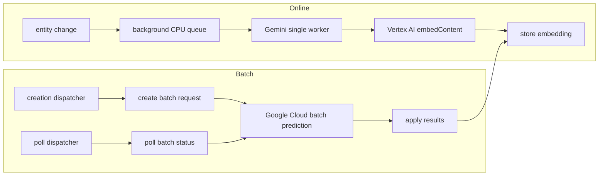

# Gemini Embeddings

Voucha uses Vertex AI Gemini Embedding 2 for text and image embeddings. The single pipeline serves
online requests for posts, topics, and RSS feed items. The batch pipeline handles durable work,
including refreshes and entity types without an online path. Both write vectors into the canonical
entity embedding columns and share content-hash deduplication for text.

## Processing paths

Online calls use direct Vertex AI HTTP requests and do not wait for a batch job. Batch creation,
status polling, result ingestion, cleanup, and reconciliation run through the bounded background CPU
queue. Callers that need immediate embeddings use the online path; durable bulk work uses batches.

The shared text cache is recomputable. Entity writes check the input hash before updating so stale
results cannot overwrite newer content. Cache reuse copies a stored vector in SQL. Bloom filter
misses skip unnecessary database lookups, while positive results always consult PostgreSQL. Durable
reconciliation scans bounded pages and enqueues continuations when a page is full.

## Entity coverage

| Entity         | Online path | Batch path |
| -------------- | ----------- | ---------- |
| Posts          | Yes         | Yes        |
| Topics         | Yes         | Yes        |
| RSS feed items | Yes         | Yes        |
| Crawl chunks   | No          | Yes        |
| Images         | No          | Yes        |

## Runtime configuration

Online and batch requests use the Vertex project and workload identity configured for each runtime.
Local development uses Google Cloud application default credentials; deployed workloads use
workload identity federation. See the [local setup reference](../../development/local-development/reference-gemini-embeddings-local.md)
and the private infrastructure runbook for environment-specific identity configuration.

## Related

- [Services architecture](services/README.md)
- [Queue architecture](queues/README.md)
- [Backend rules](../../../backend/AGENTS.md)
- [Backend services rules](../../../backend/services/AGENTS.md)
