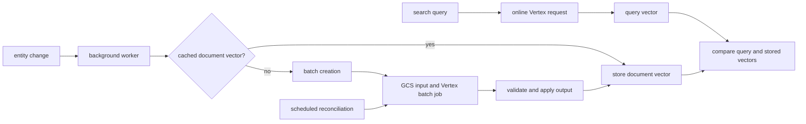

# Gemini Embeddings

Voucha uses Vertex AI Gemini Embedding 2 for search queries and stored document vectors. Query
embeddings need an immediate response, while document embeddings can be generated asynchronously.
Online work serves queries; entity changes first reuse an existing document vector, then enter the
batch pipeline when no vector is available. Background reconciliation discovers work missed by
entity-triggered enqueueing.

## Processing paths

Text entities share a recomputable cache keyed by a framed identity of the full canonical title and
body. The identity is separate from the bounded prompt sent to Vertex: title and body are composed
with the model's required prefix, then sampled against an estimated-token budget with margin. The estimator is approximate rather than
Google's tokenizer, so this budget does not guarantee staying below the model's actual token limit.
Provider truncation is accepted and recorded so multilingual documents can complete despite that
estimation gap; canonical identities still cover the full unsampled document. Image inputs use their
own source identity. Batch output is matched to the submitted manifest, and entity writes compare
the submitted identity with the current entity identity before applying a result. This prevents a
job from overwriting newer content or applying an output to the wrong entity.

Online `embedContent` and batch prediction use different Vertex API surfaces. Online requests use
`aiplatform.us.rep.googleapis.com`, the US multi-region host listed in Google's [Vertex AI locations
reference](https://docs.cloud.google.com/gemini-enterprise-agent-platform/resources/locations). The
[online embedding API reference](https://docs.cloud.google.com/gemini-enterprise-agent-platform/reference/rest/v1/projects.locations.publishers.models/embedContent)
documents the operation itself. Batch jobs for the `us` location use
`us-aiplatform.googleapis.com`, as shown in the [Gemini embedding batch
guide](https://docs.cloud.google.com/gemini-enterprise-agent-platform/models/embeddings/batch-prediction-genai-embeddings).
Both hosts are required in outbound network policy.

Batch inputs, submitted manifests, and provider outputs must remain available in Cloud Storage for
at least seven days and longer than the configured provider-job and ingestion-retry lifetimes. This
retention is an infrastructure invariant: the application does not enforce bucket lifecycle
configuration. Result ingestion pins output to a Cloud Storage generation and can replay that exact object: it
validates the complete provider output before database writes without materializing the full output
on local disk. Persisted batch admission cardinality and fixed line and byte bounds limit the work;
dynamic configuration can lower the admitted cardinality but cannot raise those fixed bounds.

Creation, provider reconciliation, and result ingestion run through bounded background jobs.
Continuations preserve progress when a scan reaches its work limit. Provider-success ingestion has a
bounded queue-attempt budget; the final failed attempt conditionally fails the batch and removes
its membership so pending scans can retry the work. Idempotent hash-keyed writes make repeated
deliveries harmless; membership suppresses duplicate work on a best-effort basis and does not claim
exclusive entity ownership. The configured total batch lifetime also retires successful output
abandoned by a crashed or stalled worker; it does not cancel an already completed provider job.
The existing daily data-retention sweep expires recomputable shared
cache rows in bounded pages while entity vectors remain stored inline. If submission returns without a receipt, reconciliation checks the deterministic
provider display name before another paid submission is considered.

## Runtime identity

Both local and deployed calls use AWS workload identity federation. The standard AWS credential
chain supplies the AWS identity; Google STS exchanges its signed identity assertion and IAM issues
a short-lived service-account access token. The application does not use Google application
default credentials or a Google service-account key.

See the [local setup reference](../../development/local-development/reference-gemini-embeddings-local.md)
and the private infrastructure runbook for environment-specific identity setup.

## Related

- [Services architecture](services/README.md)
- [Queue architecture](queues/README.md)
- [Backend rules](../../../backend/AGENTS.md)
