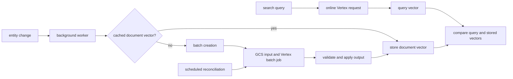

# Gemini Embeddings

Voucha uses Vertex AI Gemini Embedding 2 for search queries and stored document vectors. Search
queries need an immediate response, so they use the online endpoint. Entity changes reuse a cached
vector when possible and otherwise enter the batch pipeline, keeping background work separate from
user-waiting requests.

## Processing paths

Text entities share a recomputable cache keyed by canonical content hashes. Batch output is checked
against the submitted manifest, and entity writes check the current content hash before applying a
result. This prevents a job from overwriting newer content or applying an output to the wrong
entity. Clustering and other entity-to-entity comparisons use the same stored document vectors.

Creation, provider reconciliation, and result ingestion run through bounded background jobs.
Continuations preserve progress when a scan reaches its work limit. Failed ingestion remains
retryable instead of acknowledging a provider job before its results have been stored.

## Runtime identity

Both local and deployed calls use AWS workload identity federation. The standard AWS credential
chain supplies the AWS identity; Google STS exchanges its signed identity assertion and IAM issues
a short-lived service-account access token. The application does not use Google application
default credentials or a Google service-account key.

See the [local setup reference](../../development/local-development/reference-gemini-embeddings-local.md)
and the private infrastructure runbook for environment-specific identity setup.

## Related

- [Services architecture](services/README.md)
- [Queue architecture](queues/README.md)
- [Backend rules](../../../backend/AGENTS.md)
