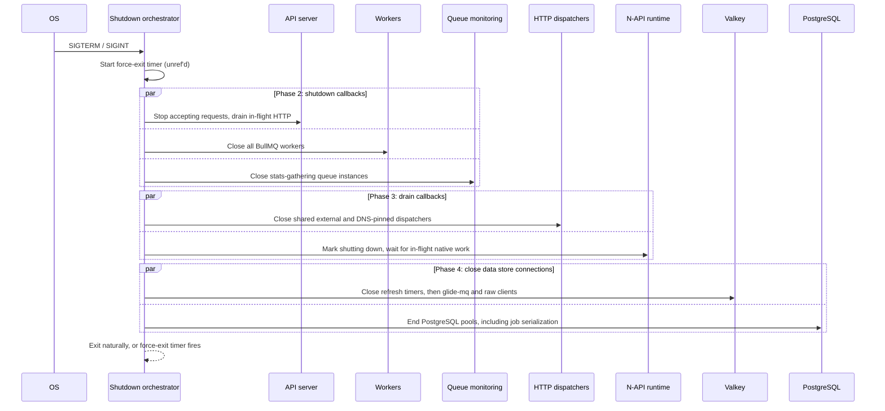

# Graceful Shutdown

Backend processes shut down in a strict sequence when they receive `SIGTERM` or `SIGINT`. The orchestrator lives in `backend/data-stores/graceful-shutdown/index.mts`.

## Shutdown Sequence

The orchestrator drives each phase in order, running every callback within a phase in parallel:

PostgreSQL closes its lazily populated pools. Their combined maxima describe a worst-case
per-process connection budget, not connections reserved at process start.

## Registration APIs

| Function                               | Purpose                                                                      |
| -------------------------------------- | ---------------------------------------------------------------------------- |
| `addGracefulShutdownCallback(fn)`      | Phase 2 — stop accepting work and finish in-flight requests                  |
| `addGracefulShutdownDrainCallback(fn)` | Phase 3 — close/drain subsystems that must wait for in-flight work to finish |

Entry points register their shutdown logic at startup:

- **Server** (`backend/entrypoints/api/serve.mts`): registers HTTP terminator callback + N-API drain
- **Worker** (`backend/entrypoints/worker/serve.mts`): registers worker close callback + N-API drain
- **Dev** (`backend/dev.mts`): registers HTTP terminator callback; imports worker/serve.mts for worker + N-API drain

Valkey concern packages self-register with `@data-stores/graceful-shutdown` on import, so loading
`@data-stores/valkey-pubsub`, `@data-stores/valkey-rate-limiter`, or
`@data-stores/valkey-glide-mq` is enough to wire their shutdown cleanup without importing the
`@data-stores/valkey` barrel.

## One-Off Commands

One-off entrypoints that must make successful cleanup part of their result contract use
`shutdownDataStoresForOneOffCommand()`. Unlike signal shutdown's best-effort reporting, this path
is quiet and rejects with every Valkey/PostgreSQL close failure after attempting both stores. Its
force-exit timer stays referenced while cleanup is pending, so an unresolved close is bounded; it
becomes unref'd after cleanup settles and fires only when a residual native handle prevents natural
termination. Any force-exit is nonzero: even after cleanup succeeds, a residual handle is not a
clean one-off termination. The Valkey admin command emits completed operation evidence before
starting strict shutdown, so a cleanup failure cannot hide a destructive operation and invite an
unsafe retry.

## N-API Runtime Drain

The Rust N-API packages (`@jongleberry/vurst-markdown`, `@jongleberry/vurst-html`, and `@jongleberry/vurst-ai`) wrap all native function calls in a shared TypeScript runtime that tracks in-flight promises. During shutdown:

1. `beginNativeAddonShutdown()` — marks the runtime as shutting down; new native calls throw immediately
2. `waitForNativeAddonWorkToDrain()` — resolves once all in-flight native promises settle

This prevents V8/N-API teardown crashes where native completion callbacks fire after Node.js has started destroying the JS environment.

## Rules

- **Never call `process.exit()` or `process.kill()` in runtime code.** Use `addGracefulShutdownCallback` or call `onGracefulShutdown` directly for fatal errors.
- **The force-exit timer is the only place `process.exit()` is allowed.** It handles NAPI handles (e.g. `@glidemq/speedkey` threadsafe functions) that keep the event loop alive after all JS connections close.
- **Do not use `process.emit('SIGTERM')`** — banned by Oxlint's restricted process lifecycle rules.

## Test Teardown

Test teardown drains native work before closing data store connections. It uses a direct cleanup
path rather than signal handling, and each test remains responsible for its queued jobs. The main
process owns shared test connections, so its teardown must expose handles that prevent a clean exit.
A bounded teardown and process-resource snapshots make a genuine hang diagnosable even when routine
diagnostics are disabled.

## Fork-Side Leak Detection

Main-process teardown cannot detect resources leaked inside a test fork: terminating the fork can
hide handles that it never closed. A separate detector therefore follows resource growth across the
fork's entire sequence of test files. Its state must survive the module resets between files, so
continued growth remains attributable even when each individual file contains few tests.

`vouchington-tooling/vitest-diagnostics` owns resource sampling, bounded handshake settling, growth
detection, and process-resource diagnostics. Voucha supplies PostgreSQL pool metrics and registered
pool socket identities through test-only adapters. This connection context distinguishes expected
lazy pool initialization from unexplained resource growth; aggregate resource counts alone cannot
identify which socket belongs to a pool. Unmatched handles and uncertain mappings remain visible to
the detector. Production does not install the test identity hooks.

Background work must settle before attribution so one test's normal in-flight work is not blamed on
a later test. A stable pool expansion can become a new baseline, while continued growth fails the
affected test. Failure diagnostics retain resource evidence and application pool context, connecting
the fork-side signal with the main-process teardown boundary.

## Related

- Process lifecycle rules: [../../../backend/AGENTS.md](../../../backend/AGENTS.md)
- Data stores: ../../../docs/overview/architecture/backend/README.md
- N-API runtime package: `@jongleberry/vurst-runtime`
- [Runtime Timeouts](../../development/runtime-timeouts.md#principle-sse--long-lived-connection-duration-under-fargate-spot) — the Fargate Spot interruption-notice window that SSE/long-lived connections must degrade within; distinct from this doc's own `GRACEFUL_SHUTDOWN_PERIOD_SECONDS` force-exit timer above — don't conflate the two
