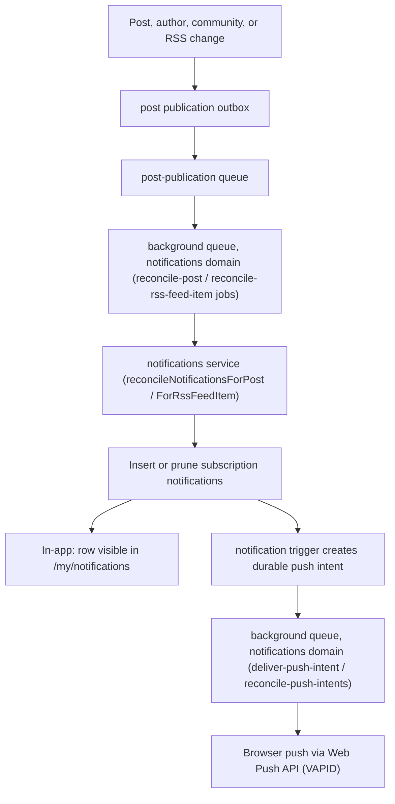

# Notifications

Cross-service notification system: subscription-based delivery, manual sends, and browser push.
Subscription rules and client behavior are in the
[notification requirements](../../requirements/navigation/NOTIFICATIONS.md).

## Architecture

The fan-out pipeline flows from durable publication reconciliation to per-channel delivery:

## Why it is shaped this way

- **Reconciliation, not event handlers.** Notifications are derived by idempotent reconcile jobs
  that run repeatedly, because topic and tag classification completes asynchronously. Flagged or
  deleted content does not notify, read notifications are kept even if the entity later stops
  qualifying, and only subscription rows take part in reconciliation (manual sends are snapshots).
- **Retained identities.** Rows reference retained post and RSS identities so reconciliation can
  find a row after the live display FK is cleared; a retained identity never makes deleted content
  visible.
- **Push is a durable intent.** The notification trigger records a push intent in the same
  transaction as the notification write, and a recovery schedule re-enqueues pending work. Delivery
  records per-endpoint receipts so a retry never resends to an endpoint that already succeeded.
  Only a permanent provider rejection invalidates a registration.
- **Endpoint ownership is generation-bound.** Each enable creates a subscription generation and a
  global registry maps an endpoint digest to exactly one active owner, so a late provider result can
  never alter a replacement owner. Payloads without the exact binding are rejected.
- **Reports leak nothing.** Report-review notifications are generic and route to the inbox; copy
  never exposes the reported target, reporter note, or moderator identity.
- **Digest catch-up preserves complete weeks.** A sent-through cursor records completed windows,
  while GlideMQ owns attempts and recipient-page progress. Scheduled recovery re-admits unfinished
  windows with stable identities. The cursor advances only across a contiguous completed window,
  so a failed predecessor cannot be skipped. Replayed recipient pages reuse notification event keys
  and delivery receipts instead of sending another digest.
- **No raw external URLs.** RSS item notifications carry only an internal redirect id; the server
  resolves the destination.

Post-publication owns subscription reconciliation and notification dispatch; the notifications
domain owns push delivery and recovery.

## Related

- [Services map](services/README.md) and [queues map](queues/README.md)
- [Web rules](../../../web/AGENTS.md) and [Backend rules](../../../backend/AGENTS.md)
