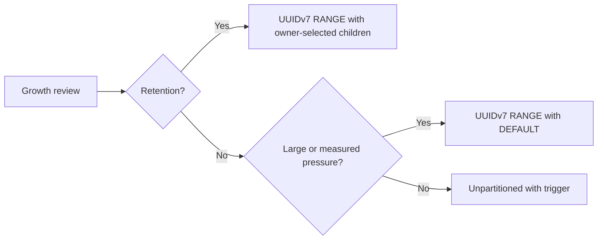

# PostgreSQL Partitioning Strategy

This is the decision record for PostgreSQL table growth. The per-table partition and
unbounded-table policies, with their rationale and reconsideration triggers, live in
[`schema-growth-registry.mts`](../../../backend/data-stores/psql/schema-growth-registry.mts).

## Policy

- Internal row, entity, and event IDs are UUIDv7. Natural/provider keys and the small static
  identity lookups are documented exceptions in the registry.
- Use `RANGE` on the UUIDv7 row or owning-parent key. HASH partitioning is forbidden.
- Tables without retention start with one `DEFAULT` child. Add explicit aligned ranges once
  measured planner/write pressure or growth warrants it.
- Monthly children are retired by `cleanupPartitions`. Eligible content-history ranges are
  retired only through the manual guarded range command after their owner has split them from
  the default child. A default child has no upper bound and cannot be dropped.
- Every drop is checked in the backend against its declared window, open legal holds and
  unfinished work. A refusal leaves other eligible partitions available for retirement. The
  admin status preview caps row probes and marks unchecked monthly children `check-pending`;
  retirement always performs its own locked check before detach.
- An unpartitioned table classified as unbounded must record both its rationale and the condition
  that would trigger reconsideration.



`web_push_endpoint_owners` is intentionally unpartitioned: its SHA-256 endpoint key is the global
serialization and uniqueness point across the user-partitioned `web_push_subscriptions` table.
`notification_push_intent_subscription_receipts` retains delivery outcomes by exact subscription
generation, rather than an endpoint-only key.

`session_referral_attributions` ages out anonymous (`user_id IS NULL`) rows by batch deletion;
user-linked rows live with the account, and `deleteUser` nulls `user_id` so they join the sweep.
Its current default partition has no declared drop window. A future range-drop policy must
account for live user-linked rows before the owner can declare one.

## Operating Explicit Ranges

A populated default overlaps every prospective range. Create a standalone matching table, move the
range out of the default, validate range and default-exclusion `CHECK` constraints, then attach it.
Align bounds across tables joined by the same UUIDv7 parent key. Monitor defaults through the
partition-status API and `pg_total_relation_size()`.

For a content-history range, record its parent table, child name, and both UUIDv7 bounds at split
time. Run the owner command from the repository root with its normal backend database connection:

```sh
pnpm run db:retire-history-range -- <table> <partition> <from-uuidv7> <to-uuidv7>
```

The command accepts only declared content-history parents. It requires the live catalog to match
the supplied finite bounds and parent, then locks the live owner, preservation holds, FK targets,
parent, and child before checking the catalog again. `NOWAIT` refuses a busy writer immediately,
leaving the range attached. The operator checks the active work and reruns the command manually
after it finishes; the command never retries. A held post author or decision actor blocks
retirement. It detaches and drops the child in that transaction. There is no automatic
explicit-range schedule; an owner must confirm the split range and run the command. Live post
clearance and topic update facts stay
on their owning rows, and clearance decision identities remain while live pointers or feedback
name them. Transparency rollups persist when a raw history partition is dropped because dropping
a partition does not fire row-delete triggers.

## Related

- [Partition Pruning Hints](partition-pruning-hints.md)
- [Database Rules](../../../backend/data-stores/psql/AGENTS.md)
- PostgreSQL queue
- [RSS feed crawling](../../requirements/content/RSS-FEED-CRAWLING.md)
- [PostgreSQL schema-growth prompt](../../prompts/scheduled/postgresql-schema-growth.md) — recurring schema-growth classification audit against this policy.
