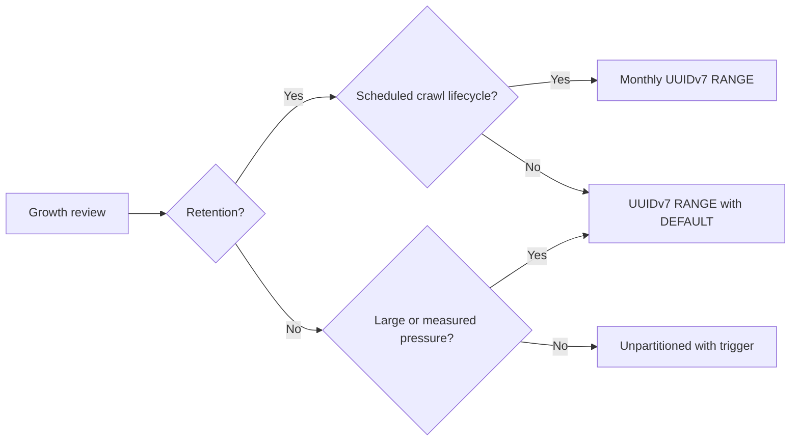

# PostgreSQL Partitioning Strategy

This is the decision record for PostgreSQL table growth. The per-table partition and
unbounded-table policies, with their rationale and reconsideration triggers, live in
[`schema-growth-registry.mts`](../../../backend/data-stores/psql/schema-growth-registry.mts).

## Policy

- Internal row, entity, and event IDs are UUIDv7. Natural/provider keys and the small static
  identity lookups are documented exceptions in the registry.
- Use `RANGE` on the UUIDv7 row or owning-parent key. HASH partitioning is forbidden.
- Tables that use operator-managed partition retirement start with one `DEFAULT` child. Add explicit
  aligned ranges on demand, then retire only ranges wholly outside the retention window. Classifier
  decision results use the batch UUIDv7 key so replay and reports remain time scoped.
- Tables without retention also start with one `DEFAULT` child. Add explicit aligned ranges once
  measured planner/write pressure or growth warrants it.
- Monthly children are retired by `cleanupPartitions`. Explicit UUIDv7 ranges may also be
  retired when their table owner declares a minimum retention window and the drop guard proves
  that the whole range is old enough. A default child has no upper bound and cannot be dropped.
- Every drop is checked in the backend against its declared window, open legal holds and
  unfinished work. A refusal leaves other eligible partitions available for retirement. The
  admin status preview caps row probes and marks unchecked children `check-pending`; cleanup
  always performs its own locked check before detach.
- An unpartitioned table classified as unbounded must record both its rationale and the condition
  that would trigger reconsideration.

`web_push_endpoint_owners` is intentionally unpartitioned: its SHA-256 endpoint key is the global
serialization and uniqueness point across the user-partitioned `web_push_subscriptions` table.
`notification_push_intent_subscription_receipts` retains delivery outcomes by exact subscription
generation, rather than an endpoint-only key.

`session_referral_attributions` ages out anonymous (`user_id IS NULL`) rows by batch deletion;
user-linked rows live with the account, and `deleteUser` nulls `user_id` so they join the sweep.
Its current default partition has no declared drop window. A future range-drop policy must
account for live user-linked rows before the owner can declare one.

## Operating Explicit Ranges

A populated default overlaps every prospective range. Create a standalone matching table, move the
range out of the default, validate range and default-exclusion `CHECK` constraints, then attach it.
Align bounds across tables joined by the same UUIDv7 parent key. Monitor defaults through the
partition-status API and `pg_total_relation_size()`.

## Related

- [Partition Pruning Hints](partition-pruning-hints.md)
- [Database Rules](../../../backend/data-stores/psql/AGENTS.md)
- PostgreSQL queue
- [RSS feed crawling](../../requirements/content/RSS-FEED-CRAWLING.md)
- [PostgreSQL schema-growth prompt](../../prompts/scheduled/postgresql-schema-growth.md) — recurring schema-growth classification audit against this policy.
