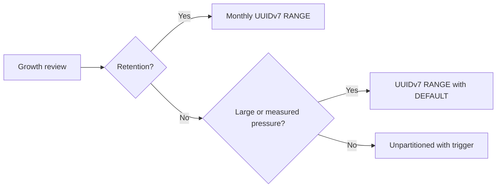

# PostgreSQL Partitioning Strategy

This is the decision record for PostgreSQL table growth. The per-table partition and
unbounded-table policies, with their rationale and reconsideration triggers, live in
[`schema-growth-registry.mts`](../../../backend/data-stores/psql/schema-growth-registry.mts).

## Policy

- Internal row, entity, and event IDs are UUIDv7. Natural/provider keys and the small static
  identity lookups are documented exceptions in the registry.
- Use `RANGE` on the UUIDv7 row or owning-parent key. HASH partitioning is forbidden.
- Tables without retention start with one `DEFAULT` child. Add explicit aligned ranges once
  measured planner/write pressure or growth warrants it.
- Monthly children are reserved for partition-drop retention owned by `cleanupPartitions`.
- An unpartitioned table classified as unbounded must record both its rationale and the condition
  that would trigger reconsideration.

`web_push_endpoint_owners` is intentionally unpartitioned: its SHA-256 endpoint key is the global
serialization and uniqueness point across the user-partitioned `web_push_subscriptions` table.
`notification_push_intent_subscription_receipts` retains delivery outcomes by exact subscription
generation, rather than an endpoint-only key.

`session_referral_attributions` ages out anonymous (`user_id IS NULL`) rows by batch deletion; user-linked rows live with the account, and `deleteUser` nulls `user_id` so they join the sweep.

A monthly-partition, partition-drop retention model is permanently off the table for this table:
a `DROP` is unconditional and cannot honor the `user_id IS NULL` predicate, so it would delete
live users' attribution history along with the anonymous rows it's meant to age out. Row-based
batch deletion is the only retention mechanism this table will use.

## Operating Explicit Ranges

A populated default overlaps every prospective range. Create a standalone matching table, move the
range out of the default, validate range and default-exclusion `CHECK` constraints, then attach it.
Align bounds across tables joined by the same UUIDv7 parent key. Monitor defaults through the
partition-status API and `pg_total_relation_size()`.

## Related

- [Partition Pruning Hints](partition-pruning-hints.md)
- [Database Rules](../../../backend/data-stores/psql/AGENTS.md)
- PostgreSQL queue
- [RSS feed crawling](../../requirements/content/RSS-FEED-CRAWLING.md)
- [PostgreSQL schema-growth prompt](../../prompts/scheduled/postgresql-schema-growth.md) — recurring schema-growth classification audit against this policy.
