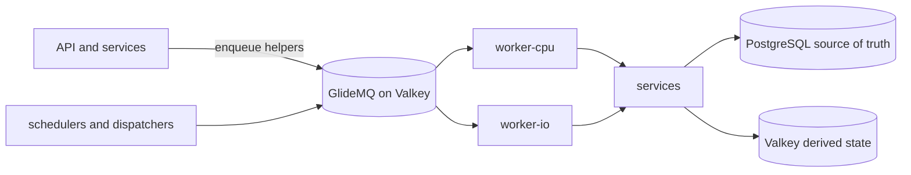

# Queues

Orientation for background work. The queue list, job names, schedules, concurrency and payloads
are code: read `backend/queues/<domain>/`, the processors in `backend/workers/<domain>/` and the
worker policy in `backend/modules/worker-queue-inventory/`. This page records how the pieces fit
and why they are shaped this way. Authoring rules live in the
[queue checklist](../../../checklists/backend-queues.md) and
[`backend/queues/AGENTS.md`](../../../../backend/queues/AGENTS.md).

## Topology

- `backend/queues/<domain>/` owns names, config, payload parsing and `enqueue*` helpers. It is safe
  for the API and workers to import and never imports a worker.
- `backend/workers/<domain>/` owns processors. A processor parses the payload and calls a
  [service](../services/README.md); business logic never lives in the worker.
- The PostgreSQL queue uses the same job names for scheduled crawl partition maintenance and
  operator actions. Only an authenticated admin request carries explicit classifier batch bounds;
  scheduled payloads remain empty, so classifier ranges are never created or retired on a schedule.
  Explicit classifier ranges share one ordered lane. A bounded retention sweep publishes its next
  page as a distinct queued job so a backlog drains without waiting for the next schedule.
- `backend/worker-runtime/` wires workers, and `backend/entrypoints/{worker-cpu,worker-io}/` choose
  which run in a process. Infrastructure decides the deployed split; local development runs one
  process for everything.
- The shared `background` queue serves many small domains. A job is `<domain>.<name>`, a registry
  maps each to a handler, and ordering keys and concurrency are per domain or per job-family lane;
  pause remains per domain. ActivityPub reserves capacity for inbound and outbound delivery so
  hostile inbound traffic cannot occupy outbound delivery slots. Outbound follower-page dispatch
  has a separate lane so a large audience cannot queue behind its own delivery tasks. Outbound
  recovery has its own lane so a pending-state sweep can run while fan-out pages occupy dispatch
  slots. Domain rows retain the current ActivityPub publication state; indexed reconciliation can re-admit a missed
  distribution after a database commit or a failed continuation. Recovery carries each retained
  follower page's dispatch receipt into its replacement job, so a completed page resumes its
  continuation without re-admitting that page's delivery jobs. Retention cleanup has its
  own lane independent of delivery backlogs to keep inbox capacity reclaimable under sustained
  traffic. Inbound recovery also has a separate lane so a flood of deliveries cannot delay repair. A domain that
  needs both a domain-wide cap and per-entity ordering keeps its own queue.
- The shared `background-cpu` queue applies the same domain model to crawling, embedding, spend-cap
  coordination, and content analysis. URL and referral crawls use the same hostname ordering key,
  so they respect one external host limit. Provider limits use group rate windows; database-only
  work uses concurrency. Long network jobs keep their own lock settings. Operators can pause and
  inspect each domain without pausing unrelated CPU work.
  Domain processors load at dispatch so unrelated domains can start without initializing every
  processor dependency. Global upload maintenance retains startup initialization, and eager
  registry validation rejects unroutable jobs before the worker starts.
- An ordering lane's concurrency is a global cap across every worker process. The shared worker's
  `workerConcurrency` sizes slots in one process; adding processes does not multiply the lane cap.
  DynamicConfig sets lane caps at producer admission and scheduler registration. Dispatchers use
  separate lanes where GlideMQ's ordered group FIFO would otherwise place them ahead of ready tasks
  regardless of queue priority.
  GlideMQ retains each scheduler's template options. After changing a lane cap, let DynamicConfig
  reach queue producers, then restart the schedule-owning worker processes so they re-register all
  affected shared-queue templates. Later scheduled ticks use those persisted templates; an old
  template could otherwise reset the lane to its previous cap when that tick inserts a job.
- Unfurl jobs run with the shared CPU worker selection and can use Lightpanda. Deployments that
  select the CPU worker need the browser capability and capacity for unfurl work as well as crawls.

## Why queues are shaped this way

Moderation reconciliation and Bedrock batch polling carry a fixed sweep boundary through bounded
continuations, so unchanged active rows cannot monopolize every page. Moderation reconciliation
indexes unfinished work so completed history cannot dominate page reads. Invalid-crawl cleanup
retains its age cutoff while committed deletions advance the remaining-work predicate; its candidate
index excludes successful historical crawls from each page. A continuation keeps work eligible
without holding a worker through the entire backlog.

Moderation-history retention uses the existing PostgreSQL maintenance queue and a serial ordering
lane. A scheduled or operator seed starts a bounded sweep; each completed job immediately admits
a distinct continuation for only its unfinished record families. Native job receipts preserve the
page result before child admission, so a retry of a receipted parent reuses the same child identity.
PostgreSQL cursor progress remains authoritative; a crash before the receipt can replay bounded,
idempotent cleanup. Daily and operator seeds recover lost queue state or terminal failures.

Image deletion fences delivery before processing posts that share the image. Each continuation
commits a bounded page of post resets and deletion revisions with its cursor and pending listener
admissions. Admission retries drain that receipt before mutating another page, so a lost queue
acknowledgement cannot reset a post again. Image maintenance re-admits unfinished deletions;
root admission coalesces overlapping sweeps so backpressure cannot accumulate dispatchers.
Source storage and quarantined-image renders are removed only after the final page commits and
its listener work is admitted. Quarantine deletion still requires a confirmed permanent copy.

The data-retention schedule runs in deployed environments so staging exposes retention failures
before production. Staging assigns the job lower queue priority to keep interactive and recovery
work ahead of housekeeping. Membership retention pages persist their position. A capped run
enqueues a retention continuation step naming the membership families with more eligible rows,
and that step reruns only those families, keeping the backlog draining between schedules.

- **PostgreSQL is the source of truth; the queue is a delivery hint.** Deduplication reduces
  duplicate enqueues but is never the correctness boundary, so every processor is idempotent against
  durable state. There is no dead-letter queue: each queue needs a backfill, a self-healing
  reconciler, or a documented accepted loss. See [job replayability](../../../requirements/platform/JOB-REPLAYABILITY.md). Worker sizing is covered in [worker performance](../../../development/worker-performance.md).
- **Never enqueue and wait.** A request or job does not block on another job's result. Clients poll
  durable state; a job that needs a result calls the service directly.
- **Post-commit effects wait for admission, not completion.** When a mutation promises a cache
  invalidation, notification, or follow-up action, its completion waits for queue admission and
  the required Valkey writes. It never waits for worker execution or delivery to an external
  provider. Admission failure is reported once without rejecting an already committed request;
  durable reconcilers remain responsible for recovery. Advisory enrichment and independently
  scheduled reconciliation hints may run detached when they are outside the response contract.
  A response must not claim an action is queued while its admission is still pending.
- **Blocklist membership rebuilds wait out replica lag.** URL and email blocklist rebuilds read the
  replica. The job that follows a committed sync is delayed by a lag safety margin so that commit
  is visible, and the rebuild stays off the writer.
- **User-waiting jobs get their own queue.** Latency-critical mail a person is waiting on (login,
  verification) is isolated from bulk digest work, so it never waits behind a digest backlog.
- **A `limiter` exists only for an external rate limit.** Database-only work is throttled with
  concurrency. Provider 429s and domain pauses defer the single job (`moveToDelayed`, which spends no
  attempt), never `RateLimitError` or `worker.rateLimit()`, because those idle the whole shared
  worker and one slow provider would stall unrelated domains.
  Bedrock Retry-After state is shared by its ordering lane and checked before provider work, so
  newly queued priority jobs observe the same cooldown while unrelated CPU domains keep running.
  Embedding batch creation uses one ordering lane per entity type for fair admission, a shared
  provider cooldown for 429 responses, and a renewable Valkey lease for its cross-type creation
  cap. A quota-delayed type releases that lease before deferral, leaving other ready types eligible.
- **Fan-out is paged.** Dispatchers and backfills enqueue one bounded page and continue through a
  cursor, so no run reads unbounded rows and priority stays meaningful.
- **A paged import survives a lost dispatcher.** User RSS and admin topic imports share the
  `background` queue, each import with its own dispatcher chain, so a large import never starves a
  small one. A dispatcher can be lost, so a scheduled sweep re-dispatches unfinished imports whose
  progress stopped; every step is idempotent, so the sweep is safe to repeat. Because imports have
  no row cap, an import's status is counters plus a keyset-paged row list, never every row at once.
  RSS row processing uses a nonblocking session lock because recovery and crawler continuations can
  overlap before the terminal update. A contending delivery defers; it does not repeat creation or
  quota side effects. These locks use a separate bounded connection pool so nested vote locks cannot
  exhaust the sessions needed to finish an import. No transaction stays open across feed I/O.
  Daily creation admission uses the durable row identity, so retrying a failed write reuses its
  quota charge. HTML discovery retains an outcome for each page in the row’s resolution chain;
  replay starts from the submitted URL and reuses completed hops, including protocol fallback.
  A successful crawl whose outcome cannot be persisted stays pending for recovery.
- **Instance metadata is optional.** Fediverse instance creation persists the topic before its
  NodeInfo enrichment job. The create response does not wait for an external host. A lost or
  exhausted enrichment job leaves nullable metadata unclassified; the topic and its hostname
  remain usable. This is accepted loss for advisory metadata, unlike an RSS import row, whose
  pending state has a recovery dispatcher.
- **Dispatchers rank below tasks across independent lanes.** Recovery and dispatch jobs use the
  lowest tier. Within an existing shared domain lane, GlideMQ's group FIFO decides the order before
  queue priority; those domains retain their established ordering.
- **Email cannot be exactly-once.** PostgreSQL and the mail provider do not share a transaction, so
  each processor picks one contract: retryable (may duplicate) or at-most-once (a delivery marker is
  committed before the send, and may lose the email). Jobs marked sensitive are removed on either
  successful completion or failure so a credential never outlives the job.
- **Reauthentication email loss is recoverable by the person requesting a new code.** Its sensitive job may duplicate delivery on a retry, but verification still consumes a purpose-scoped code once.
- **Spend admission is single-sourced.** Every call that can incur billed model spend goes through
  one spend-cap decision point, and capped jobs park until the daily rollover instead of failing.
  The coordinator that releases them is deliberately not behind the provider limiter.
- **Deletion and money paths recover from durable rows.** Account deletion, membership refunds and
  OAuth exchange keep their work in PostgreSQL with fenced leases, so terminal queue failure can
  never silently mark the work complete or issue a duplicate refund.

## Vote-weight recovery

Account age milestones, membership expirations, and family-source changes have separate indexed
lookback windows. They enqueue the same idempotent recalculation from current facts;
expiration also includes direct memberships, whose recalculated weight may stay unchanged.
Family changes read each timestamp independently, including rejected provider evidence of any kind.
A bounded continuation preserves the original window and each unfinished branch's keyset. Its
stable identity prevents a retried parent from multiplying the remaining page chain.
Rejected evidence resolves durable lineage owners even after newer observations or retired
projections replace the rejected entitlement; its recipient keyset handles shared family sources. The
lookback deliberately re-reads recent changes while event-keyed job ids identify repeated triggers.
Operators expand the relevant DynamicConfig lookback after an outage; the next sweep recovers that
window without a relational checkpoint. Continuations retain their fixed window in job data.

OAuth linking, family mutations, passkey mutations and role grants leave a durable dirty marker in their transaction. This
protects changes that commit beyond a dispatch window or coalesce with an active event job. A separate
indexed recovery pass selects unrecalculated live accounts without administrator overrides. Successful
recalculation removes them from that set, so this pass needs no persisted timestamp cursor.

Source writers enqueue after commit. Operator backfills use the configured signal lookbacks through
bounded pages. The age backfill also recalculates every
eligible live user, recovering current weights even when the original membership signal has ended.
Replaying an event can reactivate its retained completed or failed queue record; a waiting or
running record keeps its claim. Election replay has its own
bounded dispatcher and does not recalculate weights or change administrator overrides.

## Membership verification recovery

Verification writes admit work after commit. Pending domain rows remain recoverable when admission
or Valkey state is lost; queue retention does not authorize an outcome. Recovery fixes a sweep's
upper UUID bound and continues by verification ID in job data, so a failing early verification cannot
starve later rows. Repeated scheduled sweeps revisit earlier IDs to cover out-of-order commits.
Verification tasks and recovery pages use separate concurrency lanes so externally submitted
purchases cannot occupy the dispatcher lane. Each verification retains its job and deduplication
identity while pending purchases and provider throttles delay that job. Per-verification ordering
isolates these waits; a token-owned Valkey execution lease enforces the global provider-call cap
and is released before deferral, so a delayed purchase cannot block unrelated verifications.
Source recovery admits the same canonical verification jobs. Bound Google notification receipts
remain pending until an outcome exists and finalize on receipt replay. Unbound token-lineage
discovery shares the execution cap while it waits for a user binding.

## Related architecture

- [Crawling](../reference-crawling-components.md) explains how URL and referral crawling share CPU
  execution while embed enrichment keeps its destination-host-limited I/O path.
- [AI platform](../ai-platform.md) describes model and embedding work.
- [Fediverse federation](../fediverse-federation.md) describes federation work.

RSS alias category recovery resumes from mismatched category rows. An alias dirty generation is
acknowledged only after both item and feed mappings finish; capped pages chain through the existing
maintenance queue. Community digest catch-up likewise chains bounded weekly-window pages while
retaining the original closed-window target.

### Upload maintenance continuation

Upload cleanup retains phase progress on the actual maintenance job so a bounded page can yield
without spending a failure attempt. Snapshot persistence precedes side effects and subsequent
progress follows them. Retries can repeat an admission or object deletion if a worker stops
between an effect and its checkpoint; existing image storage lifecycle locks, extraction admission
deduplication and idempotent provider deletion remain the replay boundaries. A resumed snapshot
never recaptures a moving global range. The shared scheduler lease skips fresh ticks that overlap
an active pass. Separate retained sweeps can revisit a row between passes: locking selectors,
image lifecycle locks, and idempotent storage deletion keep those effects replayable, while
extraction admission deduplicates in-flight work. Recovery advances only after its bounded page
is admitted.

### Account security notifications

Account security notifications use the existing event-triggered email queue. The producer captures
the old primary before a settings mutation and enqueues that direct address after session
revocation; workers never resolve the recipient from the changed profile. Payloads are sensitive
and removed at their terminal outcome. Notification delivery is advisory: terminal delivery failure
is accepted loss, since account state cannot reconstruct a prior delivery address. Post-commit
admission failures are reported without changing the committed settings result.

## ActivityPub inbox envelopes

The inbox acknowledges an unknown signer before the worker fetches its key and verifies the
signature. PostgreSQL retains the exact signed request because the accepted body and envelope can
exceed GlideMQ's job-data limit. A digest of the signed request deduplicates intake and names the
queue job; verification and sender-admission checkpoints avoid repeating completed checks.
GlideMQ owns locks, retry attempts and sender delays. Final protocol outcomes delete the envelope
atomically with the activity effect and replay marker. A terminal protocol rejection completes
the queue job after that delete, and failed-job retention stays the shared bound, so a rejected
request does not retain a failed record. Only a newly inserted envelope admits work
from the HTTP route; exact duplicate requests await recovery. Recovery skips an envelope whose
UUIDv7 id is still inside the short enqueue grace, so it does not spend a replacement while the
HTTP handler is still admitting the job. Bounded recovery pages leave live
jobs alone, checkpoint retained terminal failures, and cap replacement jobs on each envelope so
queue-wide failed-record trimming cannot reset its failure budget. Failed deliveries require an
explicit rearm, which starts a new recovery budget. A crash between a database reservation and
its Valkey result can conservatively spend one slot; ordinary admission failure or deduplication
refunds the reservation.
