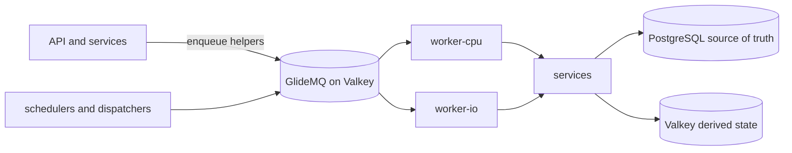

# Queues

Orientation for background work. The queue list, job names, schedules, concurrency and payloads
are code: read `backend/queues/<domain>/`, the processors in `backend/workers/<domain>/` and the
worker policy in `backend/modules/worker-queue-inventory/`. This page records how the pieces fit
and why they are shaped this way. Authoring rules live in the
[queue checklist](../../../checklists/backend-queues.md) and
[`backend/queues/AGENTS.md`](../../../../backend/queues/AGENTS.md).

## Topology

- `backend/queues/<domain>/` owns names, config, payload parsing and `enqueue*` helpers. It is safe
  for the API and workers to import and never imports a worker.
- `backend/workers/<domain>/` owns processors. A processor parses the payload and calls a
  [service](../services/README.md); business logic never lives in the worker.
- `backend/worker-runtime/` wires workers, and `backend/entrypoints/{worker-cpu,worker-io}/` choose
  which run in a process. Infrastructure decides the deployed split; local development runs one
  process for everything.
- The shared `background` queue serves many small domains. A job is `<domain>.<name>`, a registry
  maps each to a handler, and ordering keys, concurrency and pause are per domain. A domain that
  needs both a domain-wide cap and per-entity ordering keeps its own queue.

## Why queues are shaped this way

- **PostgreSQL is the source of truth; the queue is a delivery hint.** Deduplication reduces
  duplicate enqueues but is never the correctness boundary, so every processor is idempotent against
  durable state. There is no dead-letter queue: each queue needs a backfill, a self-healing
  reconciler, or a documented accepted loss. See [job replayability](../../../requirements/platform/JOB-REPLAYABILITY.md). Worker sizing is covered in [worker performance](../../../development/worker-performance.md).
- **Never enqueue and wait.** A request or job does not block on another job's result. Clients poll
  durable state; a job that needs a result calls the service directly.
- **User-waiting jobs get their own queue.** Latency-critical mail a person is waiting on (login,
  verification) is isolated from bulk digest work, so it never waits behind a digest backlog.
- **A `limiter` exists only for an external rate limit.** Database-only work is throttled with
  concurrency. Provider 429s and domain pauses defer the single job (`moveToDelayed`, which spends no
  attempt), never `RateLimitError` or `worker.rateLimit()`, because those idle the whole shared
  worker and one slow provider would stall unrelated domains.
- **Fan-out is paged.** Dispatchers and backfills enqueue one bounded page and continue through a
  cursor, so no run reads unbounded rows and priority stays meaningful.
- **A paged import survives a lost dispatcher.** User RSS and admin topic imports are the `imports`
  domain of `background`: each import has its own dispatcher chain, so a large import never starves
  a small one. A dispatcher can be lost (every attempt failed, or it stalled), so a scheduled sweep
  (`imports-recover-stalled`) re-dispatches unfinished imports whose progress stopped, reactivating
  the stable dispatcher job id; that id and the row deduplication ids make the sweep safe to repeat. An import's status is
  counters plus a keyset-paged row list, never every row at once, because imports have no row cap.
- **Dispatchers rank below tasks.** Recovery and dispatch jobs use the lowest tier so ordinary work
  runs first when both are ready.
- **Email cannot be exactly-once.** PostgreSQL and the mail provider do not share a transaction, so
  each processor picks one contract: retryable (may duplicate) or at-most-once (a delivery marker is
  committed before the send, and may lose the email). Secret-bearing jobs are removed on completion
  so a credential never outlives the job.
- **Spend admission is single-sourced.** Every call that can incur billed model spend goes through
  one spend-cap decision point, and capped jobs park until the daily rollover instead of failing.
  The coordinator that releases them is deliberately not behind the provider limiter.
- **Deletion and money paths recover from durable rows.** Account deletion, membership refunds and
  OAuth exchange keep their work in PostgreSQL with fenced leases, so terminal queue failure can
  never silently mark the work complete or issue a duplicate refund.

## Where to look by domain

- Content and publication: `post-publication`, `post-mentions`, `content-analysis`, `image-uploads`,
  `sitemaps`, `cache-purge`, `story-post-related-url-projections`.
- Imports: the `imports` domain of `background` (user RSS feed imports and admin topic imports,
  each with its own dispatcher chain, plus the `imports-recover-stalled` sweep).
- Crawling: `crawler`, `crawl-*`, `rss-feed*`, `rss-feeds`, `kagi-smallweb`, `unfurl-referral-links`,
  `urls-domains-blacklist`.
- AI: `ai-agents`, `openai-moderation`, `bedrock-embeddings*`. See the [AI platform](../ai-platform.md).
- Moderation and trust: `report-integrity`, `vote-*`, `elections`, `ban-evasion`, `spam-detection`.
- Accounts and money: `account-lifecycle`, `user-deletions`, `account-data-requests`, `memberships`,
  `emails`, `email-digests`, `notifications`, `oauth-authorization-exchange`.
- Federation: `activitypub*`, `bluesky-follow-propagation`, `follower-distributions`. See
  [fediverse federation](../fediverse-federation.md).
- Platform: `heartbeat`, `bloom-filters`, `entity-listeners`, `entity-metrics-cache-refresh`, `psql`.
