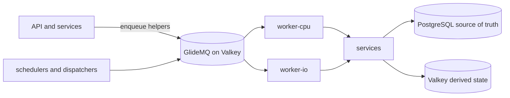

# Queues

Orientation for background work. The queue list, job names, schedules, concurrency and payloads
are code: read `backend/queues/<domain>/`, the processors in `backend/workers/<domain>/` and the
worker policy in `backend/modules/worker-queue-inventory/`. This page records how the pieces fit
and why they are shaped this way. Authoring rules live in the
[queue checklist](../../../checklists/backend-queues.md) and
[`backend/queues/AGENTS.md`](../../../../backend/queues/AGENTS.md).

## Topology

- `backend/queues/<domain>/` owns names, config, payload parsing and `enqueue*` helpers. It is safe
  for the API and workers to import and never imports a worker.
- `backend/workers/<domain>/` owns processors. A processor parses the payload and calls a
  [service](../services/README.md); business logic never lives in the worker.
- `backend/worker-runtime/` wires workers, and `backend/entrypoints/{worker-cpu,worker-io}/` choose
  which run in a process. Infrastructure decides the deployed split; local development runs one
  process for everything.
- The shared `background` queue serves many small domains. A job is `<domain>.<name>`, a registry
  maps each to a handler, and ordering keys, concurrency and pause are per domain. A domain that
  needs both a domain-wide cap and per-entity ordering keeps its own queue.
- The shared `background-cpu` queue applies the same domain model to crawling, embedding, spend-cap
  coordination, and content analysis. URL and referral crawls use the same hostname ordering key,
  so they respect one external host limit. Provider limits use group rate windows; database-only
  work uses concurrency. Long network jobs keep their own lock settings. Operators can pause and
  inspect each domain without pausing unrelated CPU work.
  Domain processors load at dispatch so unrelated domains can start without initializing every
  processor dependency. Global upload maintenance retains startup initialization, and eager
  registry validation rejects unroutable jobs before the worker starts.
- Unfurl jobs run with the shared CPU worker selection and can use Lightpanda. Deployments that
  select the CPU worker need the browser capability and capacity for unfurl work as well as crawls.

## Why queues are shaped this way

Moderation reconciliation and Bedrock batch polling carry a fixed sweep boundary through bounded
continuations, so unchanged active rows cannot monopolize every page. Moderation reconciliation
indexes unfinished work so completed history cannot dominate page reads. Invalid-crawl cleanup
retains its age cutoff while committed deletions advance the remaining-work predicate; its candidate
index excludes successful historical crawls from each page. A continuation keeps work eligible
without holding a worker through the entire backlog.

- **PostgreSQL is the source of truth; the queue is a delivery hint.** Deduplication reduces
  duplicate enqueues but is never the correctness boundary, so every processor is idempotent against
  durable state. There is no dead-letter queue: each queue needs a backfill, a self-healing
  reconciler, or a documented accepted loss. See [job replayability](../../../requirements/platform/JOB-REPLAYABILITY.md). Worker sizing is covered in [worker performance](../../../development/worker-performance.md).
- **Never enqueue and wait.** A request or job does not block on another job's result. Clients poll
  durable state; a job that needs a result calls the service directly.
- **Blocklist membership rebuilds wait out replica lag.** URL and email blocklist rebuilds read the
  replica. The job that follows a committed sync is delayed by a lag safety margin so that commit
  is visible, and the rebuild stays off the writer.
- **User-waiting jobs get their own queue.** Latency-critical mail a person is waiting on (login,
  verification) is isolated from bulk digest work, so it never waits behind a digest backlog.
- **A `limiter` exists only for an external rate limit.** Database-only work is throttled with
  concurrency. Provider 429s and domain pauses defer the single job (`moveToDelayed`, which spends no
  attempt), never `RateLimitError` or `worker.rateLimit()`, because those idle the whole shared
  worker and one slow provider would stall unrelated domains.
  Bedrock Retry-After state is shared by its ordering lane and checked before provider work, so
  newly queued priority jobs observe the same cooldown while unrelated CPU domains keep running.
- **Fan-out is paged.** Dispatchers and backfills enqueue one bounded page and continue through a
  cursor, so no run reads unbounded rows and priority stays meaningful.
- **A paged import survives a lost dispatcher.** User RSS and admin topic imports share the
  `background` queue, each import with its own dispatcher chain, so a large import never starves a
  small one. A dispatcher can be lost, so a scheduled sweep re-dispatches unfinished imports whose
  progress stopped; every step is idempotent, so the sweep is safe to repeat. Because imports have
  no row cap, an import's status is counters plus a keyset-paged row list, never every row at once.
  RSS row processing uses a nonblocking session lock because recovery and crawler continuations can
  overlap before the terminal update. A contending delivery defers; it does not repeat creation or
  quota side effects. These locks use a separate bounded connection pool so nested vote locks cannot
  exhaust the sessions needed to finish an import. No transaction stays open across feed I/O.
  Daily creation admission uses the durable row identity, so retrying a failed write reuses its
  quota charge. HTML discovery retains an outcome for each page in the row’s resolution chain;
  replay starts from the submitted URL and reuses completed hops, including protocol fallback.
  A successful crawl whose outcome cannot be persisted stays pending for recovery.
- **Instance metadata is optional.** Fediverse instance creation persists the topic before its
  NodeInfo enrichment job. The create response does not wait for an external host. A lost or
  exhausted enrichment job leaves nullable metadata unclassified; the topic and its hostname
  remain usable. This is accepted loss for advisory metadata, unlike an RSS import row, whose
  pending state has a recovery dispatcher.
- **Dispatchers rank below tasks.** Recovery and dispatch jobs use the lowest tier so ordinary work
  runs first when both are ready.
- **Email cannot be exactly-once.** PostgreSQL and the mail provider do not share a transaction, so
  each processor picks one contract: retryable (may duplicate) or at-most-once (a delivery marker is
  committed before the send, and may lose the email). Jobs marked sensitive are removed on either
  successful completion or failure so a credential never outlives the job.
- **Spend admission is single-sourced.** Every call that can incur billed model spend goes through
  one spend-cap decision point, and capped jobs park until the daily rollover instead of failing.
  The coordinator that releases them is deliberately not behind the provider limiter.
- **Deletion and money paths recover from durable rows.** Account deletion, membership refunds and
  OAuth exchange keep their work in PostgreSQL with fenced leases, so terminal queue failure can
  never silently mark the work complete or issue a duplicate refund.

## Vote-weight recovery

Account age milestones, membership expirations, and family-source changes have separate indexed
lookback windows. They enqueue the same idempotent recalculation from current facts;
expiration also includes direct memberships, whose recalculated weight may stay unchanged.
Family changes read each timestamp independently, including rejected provider evidence of any kind.
A bounded continuation preserves the original window and each unfinished branch's keyset. Its
stable identity prevents a retried parent from multiplying the remaining page chain.
Rejected evidence resolves durable lineage owners even after newer observations or retired
projections replace the rejected entitlement; its recipient keyset handles shared family sources. The
lookback deliberately re-reads recent changes while event-keyed job ids identify repeated triggers.
Operators expand the relevant DynamicConfig lookback after an outage; the next sweep recovers that
window without a relational checkpoint. Continuations retain their fixed window in job data.

OAuth linking, family mutations, passkey mutations and role grants leave a durable dirty marker in their transaction. This
protects changes that commit beyond a dispatch window or coalesce with an active event job. A separate
indexed recovery pass selects unrecalculated live accounts without administrator overrides. Successful
recalculation removes them from that set, so this pass needs no persisted timestamp cursor.

Source writers enqueue after commit. Operator backfills use the configured signal lookbacks through
bounded pages. The age backfill also recalculates every
eligible live user, recovering current weights even when the original membership signal has ended.
Replaying an event can reactivate its retained completed or failed queue record; a waiting or
running record keeps its claim. Election replay has its own
bounded dispatcher and does not recalculate weights or change administrator overrides.

## Related architecture

- [Crawling](../reference-crawling-components.md) explains how URL and referral crawling share CPU
  execution while embed enrichment keeps its destination-host-limited I/O path.
- [AI platform](../ai-platform.md) describes model and embedding work.
- [Fediverse federation](../fediverse-federation.md) describes federation work.

RSS alias category recovery resumes from mismatched category rows. An alias dirty generation is
acknowledged only after both item and feed mappings finish; capped pages chain through the existing
maintenance queue. Community digest catch-up likewise chains bounded weekly-window pages while
retaining the original closed-window target.
