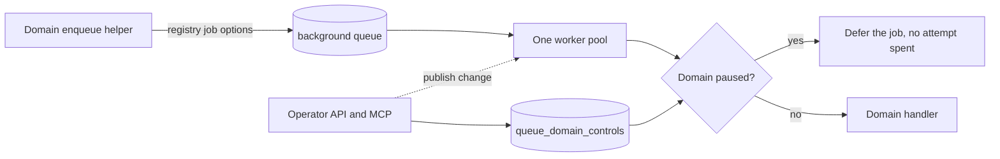

# Background Queue

Source entrypoint: [backend/queues/background/README.md](../../../../../backend/queues/background/README.md)

`background` is the one shared IO queue for background domains of the same shape. Each domain keeps
its own job names, limits, pause switch, stats, and recovery path, and runs on one worker pool
instead of its own queue, connection, and timers. The rule that sends work here is
[queue boundaries](../../../../checklists/backend-queues.md#queue-boundaries); the owning issue is
[#2855](https://github.com/vouchington/vouchington/issues/2855).

## Registry

[`registry.mts`](../../../../../backend/queues/background/enqueues/registry.mts) is the single source of truth
for what the queue runs. A domain definition names the domain's group and the baseline worker
concurrency it had as its own queue; a job definition adds the priority, `lockDuration`, `timeout`,
attempts, backoff, and retention. Every domain's jobs live in
`backend/queues/background/jobs/<domain>.mts`, and its `enqueues` helpers build on them through
`createBackgroundEnqueue` and `createBackgroundBulkEnqueue`, so a producer cannot enqueue a job the
registry does not know.

- **Names are namespaced.** A job is `<domain>.<name>`. Job ids, deduplication ids, scheduler ids,
  and ordering keys carry the domain too, so two domains can never collide.
- **A job has one ordering key, and every domain has a cap.** A domain is capped as a whole
  (`domain`: every job shares the key named after the domain, with the domain's `concurrency` and
  optional `rateLimit`; set to the domain's old worker concurrency) or runs a fixed set of singleton
  lanes (`entity`: each job supplies a key from `entityOrderingKey`, so the cap is the sum of the
  lanes). A job of a `domain` group may keep its own singleton key, such as a recovery dispatcher,
  which puts it outside the group: the domain then runs at most its group concurrency plus one pass
  per such key. A domain that needs both a domain-wide cap and per-entity keys cannot share the queue
  and keeps its own.
- **Deferral has a scope.** A provider rate-limit signal or a domain pause defers the whole group
  when the domain shares one external limit (the default). A group with `deferral: 'job'` delays
  only the signalling job, for domains whose jobs reach many independent hosts or none at all.
- **Limits are per job.** A group `rateLimit` stands in for a queue-wide `limiter`, a group of
  concurrency 1 for `setGlobalConcurrency(1)`, and a per-job `lockDuration` or `timeout` for a
  worker-level value. There is no queue-wide `limiter`.
- **Priority** follows [priority kinds](../../../../checklists/backend-queues.md#priority-kinds):
  tasks use the default tier or a tier the domain ranks below 100, dispatchers and recovery use 100.
- **Fan-out is paged.** A dispatcher or backfill enqueues one bounded page and continues through a
  cursor, because ranked priority orders only the jobs promoted together.

Moved domains: `ses-inbound`, `openai-moderation`, `post-mentions`,
`story-post-related-url-projections`, `post-publication`, `vote-aggregation`,
`entity-listeners`, `account-lifecycle`, `article-sync`,
`oauth-authorization-exchange`, `notifications`, `activitypub`, and
`follower-distributions`.

The [worker](../workers/background/README.md) pairs each registered job with its handler and refuses
to start when a job has no handler, a handler has no job, or a job has two handlers.

## Pause, retry, and stats by domain

`Queue.pause()` stops the whole queue, so a domain is paused in PostgreSQL instead: the
[`queue_domain_controls`](../../services/queue-domain-controls/README.md) row and the worker's
pre-run check. A paused domain's job is deferred without spending an attempt:

- a domain with one domain-wide group re-parks the job at the front of its group with
  `job.rateLimitGroup(recheck)`, which blocks only that group;
- a domain keyed per entity, or not grouped, delays the job with `job.moveToDelayed`.

Neither path uses `RateLimitError` or `worker.rateLimit()`: both sleep the entire shared worker, so
a provider 429 or a pause on one domain would stop every other domain. The processor therefore
converts a thrown rate-limit signal into the same two deferrals. Real-GlideMQ tests pin that
`moveToDelayed` leaves `attemptsMade` unchanged and that a paused domain does not stop another.
Resuming needs no wakeup: deferred jobs re-check on their next activation.

Operators read and control domains through
[`GET /api/v1/mq/queues/background/domains`](../../../../requirements/api/v1/mq/reference-domain-routes.md)
and the matching MCP options. Whole-queue pause and whole-queue retry are rejected for `background`.
Retrying failed jobs filters by the domain's job names.

Per-domain counts are not exact. Each count is `{ count, complete }`: `complete: false` means the
scan stopped at the cap (`domain_stats_scan_cap`), so the count is a lower bound and clients show
`count+`. Waiting, active, and delayed read the first cap jobs of the queue once per request and
bucket them by the domain's job names, because GlideMQ's name search lists every waiting id before
it filters and never sees an active priority job; when that read fills the cap, every domain's
count for that state is partial. Failed and completed search the domain's own names and are bounded
by retention, so they usually come out exact. Nothing is counted ahead of time or cached, so every
request reads the queue. The queue-wide totals on
`GET /api/v1/mq/queues` stay exact `getJobCounts()` reads.

## Configuration

The `background-queue-config` [DynamicConfig namespace](../../services/dynamic-config-admin/README.md#background-work-controls)
holds `pause_recheck_ms` (how long a paused job waits before it re-checks), `pause_cache_ms` (how
long a worker trusts a domain's pause state before it reads PostgreSQL), and
`domain_stats_scan_cap`. Fan-out page sizes stay with the domain that owns the dispatcher.

## Schedulers

Registering a manifest removes every scheduler it does not list, so each domain exports its
manifest and the worker-io entrypoint registers one combined manifest for the whole queue through
[`upsertBackgroundSchedules`](../../../../../backend/queues/background/enqueues/schedules.mts). Scheduler ids
are unique across domains.

## Retention and observability

`removeOnComplete` and `removeOnFail` counts apply to the whole queue, so a busy domain evicts
another domain's retained records sooner than a queue of its own would. Domain recovery paths that
read retained failures (for example the SES reconciler) therefore treat them as an optimization and
re-enqueue from their durable source. CloudWatch queue series and the queue inventory are keyed by
the queue name `background`; per-domain numbers come from the operator API only.

## Adding or moving a domain

1. Add the domain id to `domains.mts`, its definition and jobs to `jobs/<domain>.mts`, and register
   both in `registry.mts`.
2. Build the domain's enqueue helpers on `createBackgroundEnqueue`, export its scheduler manifest,
   and add its handlers to the worker's `handlers.mts`.
3. Remove the old queue's `queues.mts`, worker singleton, policy entry, schedule registration, and
   inventory entry, and list the dropped queue name and `WORKER_CONCURRENCY_*` override for
   infrastructure to pick up.
4. Cover the move with a real-GlideMQ test for every limit the old queue relied on.

## Related

- Worker: [../workers/background/README.md](../workers/background/README.md)
- Pause state service: [../../services/queue-domain-controls/README.md](../../services/queue-domain-controls/README.md)
- Systems overview: [../README.md](../README.md)
