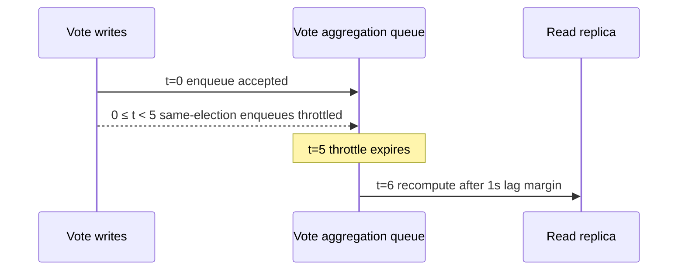

# Elections System

Source entrypoint: [backend/queues/vote-aggregation/README.md](../../../../../backend/queues/vote-aggregation/README.md)

Queue system for asynchronous vote-stat refreshes.

## Queue

| Queue (domain)                    | Job                                               | Ordering Key (100 each)            | Default Priority |
| --------------------------------- | ------------------------------------------------- | ---------------------------------- | ---------------- |
| `background` (`vote-aggregation`) | `vote-aggregation.processUpdateElectionVoteStats` | `vote-aggregation:post`            | 10               |
| `background` (`vote-aggregation`) | `vote-aggregation.processUpdateElectionVoteStats` | `vote-aggregation:entity_relation` | 10               |
| `background` (`vote-aggregation`) | `vote-aggregation.processUpdateElectionVoteStats` | `vote-aggregation:rss_feed_item`   | 10               |

The other lanes are `topic`, `hostname`, `agent_moderation`, and `user_vouch`. The payload carries the
bare lane in `orderingKey`; the job's ordering key is `vote-aggregation:<lane>`.

## Responsibilities

- refresh election vote stats after write paths enqueue follow-up work
- keep expensive stats recalculation off synchronous request paths
- coalesce each election ID into a fixed five-second throttle window, then wait one additional
  second for replica propagation before recomputing
- carry the lane (`orderingKey`) on every job and, for `entity_relation`, both the ID and its required
  metadata-validated relation table, allowing PostgreSQL to prune the relation table and UUIDv7
  range partitions; malformed queue payloads fail rather than scanning relation tables

## Related

- Vote services: [../../services/elections-votes/README.md](../../services/elections-votes/README.md)
- PostgreSQL aggregation rule:
  [../../../docs/development/postgres-schema-rules.md#large-aggregation-recomputes-read-the-replica-and-absorb-lag-asynchronously](../../../../development/postgres-schema-rules.md#large-aggregation-recomputes-read-the-replica-and-absorb-lag-asynchronously)
- Systems overview: [../README.md](../README.md)
