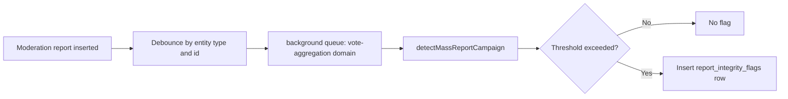

# Report Integrity Jobs

Source entrypoint: [backend/queues/vote-aggregation/README.md](../../../../../backend/queues/vote-aggregation/README.md)

Debounced queue for detecting mass-report campaigns after each new moderation report.

## Jobs

| Job                                            | Trigger                                                                                 | Description                                                                                                                                       |
| ---------------------------------------------- | --------------------------------------------------------------------------------------- | ------------------------------------------------------------------------------------------------------------------------------------------------- |
| `vote-aggregation.processReportIntegrityCheck` | Fire-and-forget from `@services/moderation-reports/integrity` after every report insert | Runs `detectMassReportCampaign`; inserts a `report_integrity_flags` row if threshold exceeded                                                     |
| `vote-aggregation.backfill_report_integrity`   | Operator backfill                                                                       | Enqueues one page of entities with pending mass-report campaigns (`backfill_batch_size`, entity id order), then continues from the page's last id |

Deduplication: `debounce` mode with a 30-second TTL per `(entityType, entityId)` pair. Rapid report
bursts collapse into a single check.
