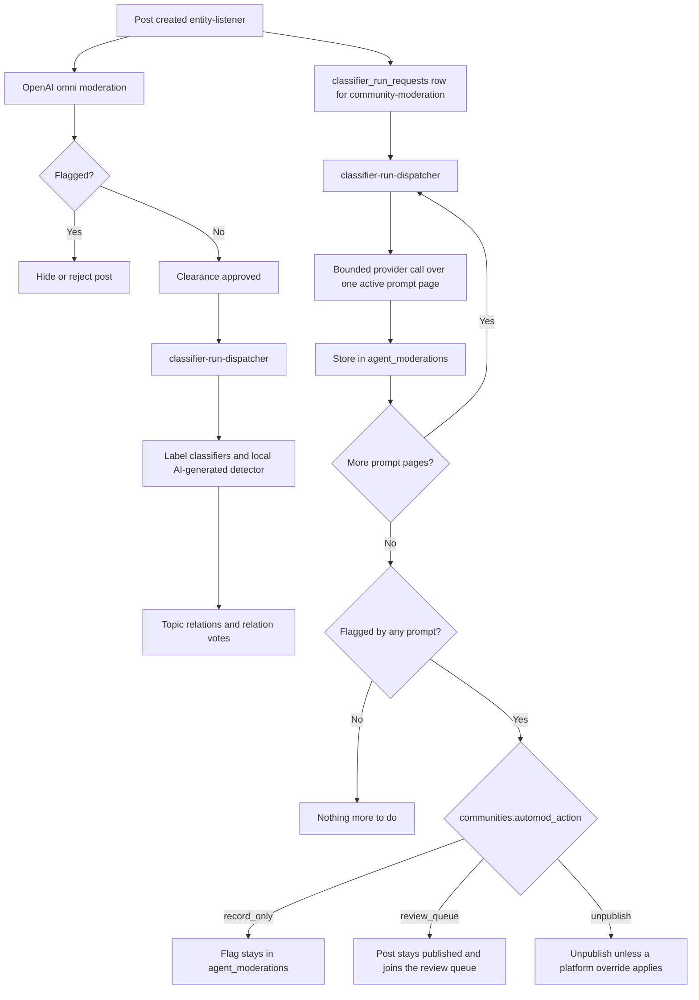

# AI Agents reference

[Back to AI Agents](ai-agents.md)

## Content Moderation Pipeline

Posts flow through two moderation layers after creation:



Admin-created posts are the exception: they publish immediately and skip the moderation branch on
create. The entity listener still runs embeddings and the autotagger, but it does not enqueue OpenAI
omni moderation, community moderation prompts, or spam detection for that
initial create event.

### Deduplication

Community prompt results are keyed by `(post_id, content_sha256, prompt_id)`. A request walks
active prompts in bounded activation-order pages. It fixes an upper position when it starts, so
new activations cannot prolong that traversal. Each page pins the exact rules it asks; reapproval
under the same complete page configuration replays without another provider call. A changed
upper cursor changes that configuration even when an earlier page's rules are unchanged. The
community action waits until the final page, when
every prompt considered by this traversal has a result. Reapproval at the same content restarts
the walk; completed pages replay without reapplying the action to a post a moderator restored.
Prompt edits behind an in-progress cursor enter the next triggered traversal rather than
rewriting earlier completed pages. Automated review-queue moves and unpublishes are attributed to
the `automod` system user.

Superseded input results have a different lifetime from current moderation decisions and moderator
evidence. A result becomes retention work when a newer decision displaces it; content edits and
evidence removal wake results whose earlier check was blocked. The cleanup keeps the newest
absolute and visible decisions, the current input, and linked evidence. It checks only due work,
so unchanged keepers do not make each daily pass grow with the history table. A qualifying sealed
transparency cohort is disclosed before its source rows leave; a cohort too small to disclose
drains privately once its sources age out. Released aggregate disclosures remain immutable.

A vote, flag, or audit insert that races a committed source deletion may fail its foreign key.
Callers should treat that as a stale result target and resolve the current moderation decision.

### Community AI Agent Toggles

Built-in post label agents are global agent definitions, but communities decide whether each one is
active for their own posts. The global system user and label mapping are shared; only the
`community_id` × `agent_id` enablement row is community-specific.

Built-in community AI agents are disabled by default. Community owners and moderators can toggle
them on the moderation settings page or through the community API. The post classifier reads these
rows when it builds a community's label configuration.

The enablement response includes an `entitlement` object:

```json
{ "allowed": true, "reason": null }
```

Today, owner/moderator access is the entitlement. Future paid plans can add plan checks in the
entitlement service without changing the API response shape or toggle UI contract.

**Built-in community AI agents:**

| Slug              | Labels                                             |
| ----------------- | -------------------------------------------------- |
| `self-promotion`  | `self-promotion`                                   |
| `marketplace`     | `buying`, `selling`, `trade`, `for-hire`, `hiring` |
| `ai-generated`    | `ai-generated`                                     |
| `politics-averse` | `political`                                        |
| `click-bait`      | `click-bait`                                       |
| `vague-post`      | `vague-post`                                       |
| `shit-post`       | `shit-post`                                        |

### Custom Moderators

Community toggles expose only the fixed-label built-in agents above. Custom community prompts use
the separate community moderation classifier (`community-moderation`) on the shared classifier-run
lifecycle: bounded provider calls cover successive active prompt pages, and the community-level
`communities.automod_action` setting (`record_only`, `review_queue` or `unpublish`) decides what a
flag does. Moderators set it from the moderation settings page.

`ai-generated` uses the local Rust `is-it-slop` detector rather than an OpenAI call. Its confidence
score and threshold are stored in `agent_moderations.results`.

Full flow details: docs/overview/architecture/queues/README.md
