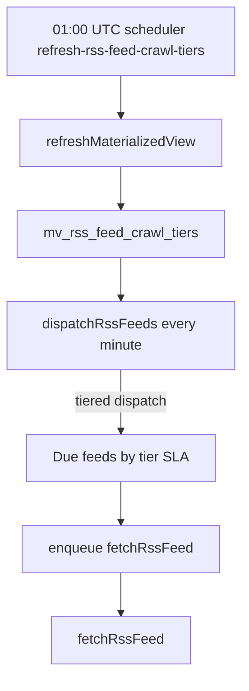

# Crawling Architecture reference

[Back to Crawling Architecture](crawling.md)

## Error Handling

All errors are recorded in the `crawls` row:

| Error                              | `response_status_code` | `network_error` |
| ---------------------------------- | ---------------------- | --------------- |
| `CrawlerTimeoutError`              | 504                    | `'timeout'`     |
| `CrawlerNetworkError` (DNS cause)  | 502                    | `'dns'`         |
| `CrawlerNetworkError` (other)      | 502                    | `null`          |
| `CrawlerRateLimitError`            | 429                    | `null`          |
| `CrawlerServerError`               | 5xx                    | `null`          |
| `CrawlerResponseSizeExceededError` | 413                    | `null`          |
| `CrawlerHttpClientError`           | 4xx                    | `null`          |
| `HttpNoBodyError`                  | 502                    | `null`          |

The crawler system retries with exponential backoff. 429 errors re-enqueue with the `Retry-After` delay. Fetch/host crawl failures may enqueue alternate same-hostname retry candidates; local persistence and S3 upload failures use only the original job's bounded retry budget. DNS lookup failures and RSS TLS certificate hostname mismatches count toward the shared hostname auto-disable counter; stale failures older than 7 days do not compound, and 3 counted failures mark the hostname non-crawlable until an admin re-enables it.

### Network backoff

Some publishers reject every connection from our egress (bot/WAF blocking). They never answer, so without a backoff each URL spends its whole retry budget on every dispatch run, which wastes most crawl jobs and risks wider blocking. Non-DNS, non-TLS-hostname `CrawlerNetworkError`s raised before any response headers arrive are counted per hostname in `url_hostnames` (HTML crawls and RSS fetches share the count). Enough consecutive failures, with no HTTP response in between, open a backoff:

- While it is open, the dispatchers leave the hostname out and preflight skips jobs already queued. The jobs are skipped, not deferred.
- When it expires, one job claims a single probe, after robots.txt and Web Risk have cleared that URL, so a skipped URL never takes the probe.
  - A failed probe reopens the backoff at the next step, which doubles the duration up to a cap.
  - Any HTTP response (even an error status, a redirect, or a body that fails or times out mid-read) closes the backoff and resets the count.

Unlike the DNS latch, the backoff never sets `is_crawlable = FALSE` and never needs an admin. The state lives in Postgres so the doubling step survives cache loss. Each open and close emits a `crawler_requests` event (`network_backoff_opened` / `network_backoff_closed`). Its `retry_after_ms` carries the backoff duration, from which the step can be derived.

Expected crawler operational failures are not reported to Sentry or stderr. They are recorded through the crawler persistence path (`crawls`, referral link health state, hostname DNS/configuration counters) and `crawler_requests` analytics, which can land in S3 Tables when the analytics Firehose backend is enabled.

## Domain Blacklist

External spam/malware domain lists are synced weekly:

1. `domain_blocklist_sources` — sources fetched from external URLs (Spamhaus, etc.)
2. `blocklisted_domains` — normalized domains from all sources
3. Bloom filters in Valkey — O(1) negative checks; populated after each sync

`checkDomainBlacklisted()` logic:

- **Feature flag off**: one full query (`url_hostnames` flags plus `blocklisted_domains`), no Bloom read
- **Bloom filter `false`** (definitely not blacklisted): only the `url_hostnames` flags read, which ran concurrently with the Bloom read
- **Bloom filter `true`/unavailable**: also reads `blocklisted_domains`

## RSS Feed Crawling

RSS feeds are fetched independently from HTML crawls. The dispatcher honors shared domain 429 locks before Web Risk, robots.txt, or feed fetch work, and RSS 429 responses extend the same lock used by HTML crawls. Vouchington injects its SSRF-pinned transport, limits, typed errors, and analytics into `@vouchington/rss-crawler`; `@vouchington/rss-parser` owns BOM, `Content-Type`, XML declaration, UTF-8/windows-1252 fallback, and feed parsing. JSON Feed responses remain UTF-8 regardless of stale charset parameters, and content hashes continue to use the raw response bytes for dedupe. Parsed JSON Feed `content_html` and `content_text` are copied onto the shared `content` and `description` fields before sanitization and embedding. Feed items are deduplicated by `(url_hostname_id, guid)`, linked through `rss_feed_item_sources`, and embedded for search.

`rss_feed_crawls` keeps crawl bodies for a bounded retention via monthly RANGE partition drop owned by `cleanupPartitions`. A month is dropped once its upper bound is older than that cutoff, so visible history is bounded the same way as `crawls`. Conditional GET etag and `last_modified_at` stay on `rss_feeds`; 304 body replay still needs a crawl row inside the retained window. After the body ages out, fetch withholds `If-None-Match`/`If-Modified-Since` so the next crawl stores a fresh 200 body instead of replaying a missing 304.
