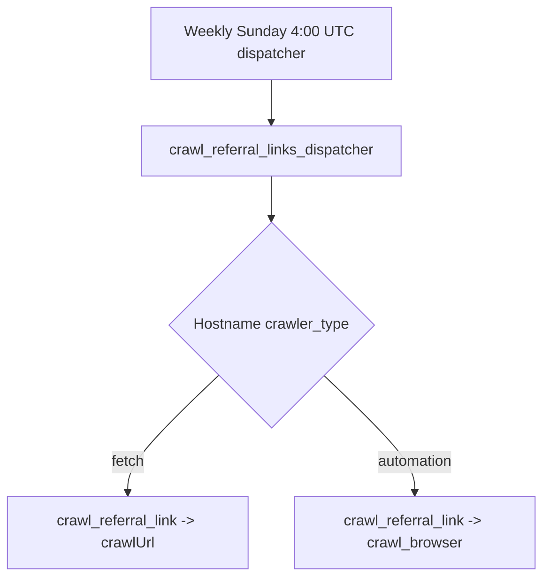

# Crawling Architecture reference

[Back to Crawling Architecture](crawling.md)

## Referral Link Crawling

Referral links use a full HTML crawl with markdown and no embeddings. The `automation` path is for client-side rendered pages; the `fetch` path uses the standard crawler.

### Auto-Deactivation Rules

| Error type          | Behavior                                                                |
| ------------------- | ----------------------------------------------------------------------- |
| Success (200)       | Reset `consecutive_crawl_failures` to 0, update `last_crawl_success_at` |
| 404/410 (removed)   | Deactivate immediately                                                  |
| 5xx / timeout / DNS | Increment `consecutive_crawl_failures`, deactivate at >= 3              |
| 429 (rate limited)  | Do NOT count as failure (server is alive), rethrow for queue retry      |

Auto-deactivation sets `activated_at = NULL`, `deactivated_at = CURRENT_TIMESTAMP`.

## robots.txt Compliance

- User-Agent: `voucha-bot https://voucha.ai/article/voucha-bot`
- robots.txt groups match the `voucha-bot` product token, not the comment URL in that header
- Robots.txt rules cached in Valkey
- RFC 9309 unavailable rules file (HTTP 4xx, including 429) → ALLOW
- RFC 9309 unreachable rules file (HTTP 5xx or a network error after retries) → complete disallow for a short period, unless a cached robots.txt body is still inside its cache entry
- Blacklisted domain → DISALLOW (before fetch)
- SSRF-rejected robots.txt target, including a private redirect, → DISALLOW before that request. See robots.txt fetches

## Related

- Workspace instructions: [backend/AGENTS.md](../../../backend/AGENTS.md)
- Worker entry point: [backend/workers/crawler/workers.mts](../../../backend/workers/crawler/workers.mts)
- docs/overview/architecture/services/README.md — error recording, embeddings workflow
- [backend/AGENTS.md](../../../backend/AGENTS.md) — backend workspace conventions
- [backend/services/crawler-html/index.mts](../../../backend/services/crawler-html/index.mts) — secure HTML fetch policy, upstream extraction, crawler error classification, and metrics
- docs/overview/architecture/services/README.md — crawler HTML service ownership and contracts
- docs/overview/architecture/services/README.md — bloom filter fast path, RFC 9309
- docs/overview/architecture/queues/README.md — job queue configuration, S3 storage
- [articles/voucha-bot.md](../../../articles/voucha-bot.md) — public-facing crawler documentation
- [runtime-timeouts.md](../../development/runtime-timeouts.md#external-calls) — why per-fetch crawler timeouts are sized as they are
