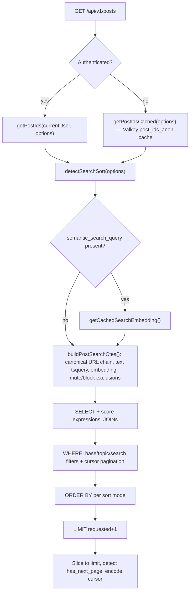

# Search Architecture

## Global Search Dialog

The global search dialog (`Cmd+K` / `Ctrl+K`) supports keyboard navigation:

| Key                          | Action                                                                                                        |
| ---------------------------- | ------------------------------------------------------------------------------------------------------------- |
| `Cmd+K` / `Ctrl+K`           | Open dialog, or refocus input if already open                                                                 |
| `ArrowUp` / `ArrowDown`      | Navigate through results                                                                                      |
| `ArrowLeft` / `ArrowRight`   | Cycle entity type tabs (All → Topics → Communities → Posts → News → Domains → Fediverse when enabled → Pages) |
| `Shift+Arrow`                | Text selection in input                                                                                       |
| `Option+Arrow` (macOS)       | Word navigation in input                                                                                      |
| `Ctrl+Arrow` (Windows/Linux) | Word navigation in input                                                                                      |
| `Enter`                      | Select highlighted result                                                                                     |
| `Escape`                     | Close dialog                                                                                                  |

ArrowLeft/ArrowRight cycle tabs when the cursor is at the boundary of the input text (start for ArrowLeft, end for ArrowRight), or when the input is not focused. Character-by-character navigation still works in the middle of a word. Modifier+Arrow shortcuts (Shift, Option/Ctrl, Cmd/Meta) always work normally and do not cycle tabs.

Post search is powered by a hybrid approach combining full-text search and semantic (vector) search.

## Fediverse Search

Fediverse search is a separate provider-bucket endpoint at `GET /api/v1/fediverse/search`. It
accepts `q`, `providers`, `type`, `limit`, and `after`, then returns buckets for PeerTube,
Mastodon-compatible servers, and Bluesky. The endpoint is always mounted; the `fediverse` feature
flag gates navigation, command-search tabs, pages, and PeerTube discovery affordances.

The v1 service is a contract shell with empty default adapters. Real provider adapters must keep
provider failures isolated to a single bucket and must not reintroduce ActivityPub inbox/outbox,
delivery queues, WebFinger, NodeInfo, or Mastodon-compatible local API routes.

## Query Entry Point

The route layer (`backend/api/v1/posts/posts-routes/posts-get.mts`) forks on auth state before
reaching the search service: authenticated requests call `getPostIds(currentUser, options)`
directly, while anonymous requests call `getPostIdsCached(options)` — a Valkey-backed wrapper
(`post_ids_anon` cache) around the same `getPostIds(undefined, options)`.

All search then goes through `@services/posts/search`:

1. **Query builder** — assembles a reusable SQL query from filter options
2. **`getPostIds()`** — executes the query, returns paginated IDs with cursor
3. **`getPostFacets()`** — returns aggregate counts (total_count) for the same query

The diagram below traces a request through the query-builder stage groups (not every filter):

## Matching and ranking

Post search combines audience, post-type, topic and text or semantic conditions on the shared
discovery query. Topic terms are conjunctive; alternate attachment sources satisfy each topic.
When keyword and semantic signals are both present, they contribute to the same relevance rank.

Hot and trending post search use a fixed-epoch rank so unchanged scores keep their ordering across
requests. Future timestamps participate in that rank. See the
[pagination contract](pagination.md) for near ties and cohort boundaries.

The scalar rank boundary is retained alongside the exact tuple cursor because tuple-only
continuations can make the planner bitmap-read and sort the tail before applying the page cap.
The redundant boundary preserves ties while keeping the measured walk on the ordered index
([comparison](https://github.com/vouchington/vouchington/pull/5372)).

## Time bound

Post search is always bounded by time, so a request reads a recent window of the newest-first id index rather than the whole table, and callers opt into longer history explicitly. The personal Feed is a separate default. Exact lookups and counts (RSS XML, pickers, facets, URL-id lookups) must not lose rows, so they opt out of the default instead of inheriting it. A drafts listing keeps the full history only when the author is viewing their own posts; the drafts flag does not widen any other search, including anonymous and cached ones.

## Visibility & Moderation Filtering

- **Privacy/broadcast**: `buildPrivacyFilter()` applies audience rules (anonymous, logged-in, followers, mutual followers)
- **Moderation**: Posts flagged by OpenAI omni-moderation are hidden from all non-owners and non-admins
- **Deleted**: `deleted_at IS NOT NULL` rows always excluded
- **Post types**: Community posts and topic recommendations follow the same discovery eligibility
  as other post types.

## Embeddings

Embeddings are generated by `@queues/bedrock-embeddings` after post creation and stored as pgvector on the `posts` table. Similarity queries use cosine distance with a pgvector index.

## Pagination

Uses the unified cursor-based pagination module. Cursors are opaque base64 strings; structure varies by sort mode. See docs/overview/architecture/backend/README.md.

## URL Search Min-Length

The URL search endpoint (`GET /api/v1/urls?query=`) requires a minimum query length after trimming (`backend/services/urls/search.mts`). Shorter queries return a 400 error. The trimmed query is matched as a literal substring: `%`, `_`, and `\` are escaped before the `ILIKE`, so wildcard-only input such as `%%%` cannot bypass the minimum length or match every URL.

Frontend guards prevent the API call before the minimum is met:

- Shared constant: `web/lib/api/url-query-min-length.ts` exports `URL_QUERY_MIN_LENGTH = 3`, plus trim/short-circuit helpers used by both API clients.
- Browser client: `web/lib/api/client/urls.ts` imports the shared helpers, trims the outbound query, omits empty queries from the request URL, and short-circuits `fetchUrls` for queries shorter than the minimum, returning an empty result immediately.
- Server helper: `web/lib/api/server/urls.ts` applies the same trim and min-length short-circuit in `getUrls`, so the `/urls` SSR page does not call the backend with a 1–2 character query and 400.
- Autocomplete components: `web/components/shared/entity-autocomplete.tsx` owns the min-length guard; the community-list and tag wrappers pass `URL_QUERY_MIN_LENGTH` for URL searches so they skip scheduling the debounced fetch and show a minimum-length hint in the dropdown instead.

## Hashtag Filter Dimensions

List-filter search supports either linked-topic or standalone `#hashtag` tokens via
`backend/services/search-params/hashtag-topic-search.mts`. Canonical hashtag keys use ASCII
alphanumeric segments separated by `-`; `.` and `_` are normalized to `-` for mobile-friendly input.
Malformed Unicode hashtag tokens remain text, including decomposed accents, so search never
silently applies a filter for only the ASCII prefix of the token.
Each parser maps linked topics and exact unlinked aliases to the appropriate SQL filter for its
surface:

- **Posts** (`parse-posts.mts`) → shared topic membership and exact standalone alias membership.
- **News** (`parse-rss-feed-items.mts`) → `hashtag_topic_ids` — one `(feed-owner-topic OR category-topic)` clause per resolved topic ID, ANDed together for multi-hashtag searches, so that `/news?q=#slug` returns items matching either ownership or categorization for that topic, overlapping with `/topic/[slug]/news`.
- **Topics list** (`parse-topics.mts`) → direct linked topic match; standalone aliases produce an empty result because they do not identify a topic.
- **RSS feeds list** (`parse-rss-feeds.mts`) → `topic_ids` — feeds where `rss_feeds.topic_id` matches the resolved ID.

RSS descendant searches probe live feeds by matching topic keys so generic prepared plans cannot
turn topic membership into a scan of enabled feeds. All-of searches test each root independently; a shared descendant can
satisfy several roots without counting duplicate relation rows. The indexed form is retained for
its measured plan stability ([comparison](https://github.com/vouchington/vouchington/pull/5372)).

Linked hashtags expand to the direct topic relation and every alias linked to that topic. Standalone
hashtags match only their exact alias relation. The `topic_ids` and `category_topic_ids` filter
dimensions for `rss-feed-items` are AND-ed when both are present. One filter is generated per
hashtag, so items must match every hashtag. Unknown valid hashtags return an empty result.

Post-search hashtag terms are ANDed together. Linked hashtags become topic terms, so aliases
rolling up to a selected topic do not impose a second exact-hashtag restriction. Standalone
hashtags retain their exact membership filter. Input validation rejects excess hashtag terms
before resolving them; REST, the website and MCP share this resolution and rejection behavior.
Newest topic search checks these terms only within a bounded inspected-post window, continuing
past its inspected key even when the page is short or empty.

See Feed And List Filters for the full surface matrix.

## Related

- [Backend rules](../../../backend/AGENTS.md) — service and data conventions
- [Web rules](../../../web/AGENTS.md) — UI and routing conventions

- [docs/requirements/navigation/TOPBAR-SEARCH.md](../../requirements/navigation/TOPBAR-SEARCH.md)
- [docs/overview/architecture/ai-agents.md](./ai-agents.md)
