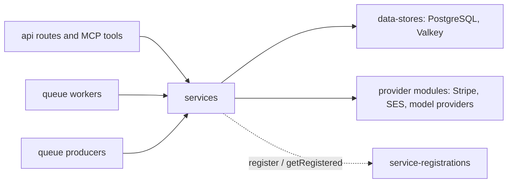

# Services

Orientation for `backend/services/`. Each package carries its own contract in code, tests and
[`backend/services/AGENTS.md`](../../../../backend/services/AGENTS.md); this page says where things
live and why the layering exists. Read the package, not a copy of it.

## Boundaries

- A **service** owns one domain's business rules, its SQL and its external integrations. Routes,
  MCP tools and workers are thin callers, so a rule exists once and REST and MCP cannot diverge.
- A service never reaches into another domain's tables. When a domain is unrelated, it is a new
  service.
- **Queues** (`backend/queues/`) only enqueue; **workers** (`backend/workers/`) only unwrap a job and
  call a service. See the [queues map](../queues/README.md).
- **Data stores** (`backend/data-stores/`) own connection and schema access; services import them,
  never the reverse.

## Where to look

- Identity and access: `users`, `jwt-session`, `oauth*`, `passkeys`, `totp`, `mfa`, `api-keys`,
  `app-attestation`, `captcha`, `recaptcha`, `user-consents`, `account-data-requests`.
- Content: `posts`, `comments`, `stories`, `topics`, `communities`, `lists`, `bookmarks`, `images`,
  `markdown`, `post-publication`, `post-revisions`, `search`, `feeds`, `sitemaps`.
- Social graph and messaging: `entity-relations`, `messaging`, `modmail`, `conversations-messages`,
  `notifications*`, `engagement-emails`.
- Moderation and trust: `moderation-*`, `review-disputes`, `user-warnings`, `copyright-notices`,
  `spam-detection`, `vote-weight`, `vote-integrity`, `elections-votes`, `report-integrity`.
- AI and classification: `classifier-runs`, `classifiers`, `post-classifier`, `autotagger`,
  `ai-usage`, `openai-*`, `bedrock-embeddings*`.
- Crawling and referral links: `crawl*`, `crawler-*`, `urls*`, `rss-feed*`, `referral-*`,
  `*-referral-program-links`.
- Federation: `activitypub-delivery`, `ap-*`, `remote-actors`, `bluesky-*`, `fediverse-*`. See
  [fediverse federation](../fediverse-federation.md).
- Money: `memberships`, `stripe`, `stripe-event-processing`, `user-financial-profiles`. See
  [monetary values](../monetary-values.md).
- Platform: `dynamic-config-*`, `feature-flags`, `queue-domain-controls`, `route-rate-limits`,
  `user-rate-limits`, `data-retention`, `psql-admin`, `valkey-admin`, `session-advisory-lock`.

## Decisions worth knowing

- **Authorization lives in `authorization.mts` as `currentUserCan*`.** One file per service means
  the REST route, the MCP tool and the worker ask the same question. SQL visibility filters belong
  there too. Branch on `error.name`, `code` or `status`, never `error.message`.
- **Dependency-inversion registries.** A service that needs a handler owned by another service
  exposes `register*()`/`getRegistered*()` instead of importing it, so the workspace dependency
  graph stays acyclic. Because a missing registration is a runtime failure, every process
  entrypoint imports `backend/service-registrations` once; `.no-mistakes.yml` enforces both halves.
- **Dedupe expensive work by content hash.** Moderation and embeddings reuse a result for
  byte-identical input rather than paying the provider twice.
- **Human approval gates AI drafts.** Dispute and appeal responses are drafted by an agent but are
  never delivered until a human approves; final resolution waits for delivery. This is a legal
  invariant of the moderation workflow, not a convenience, and the services enforce it in SQL.
- **Retained identities.** Audit and money rows (memberships, refunds, moderation history) point at
  `retained_user_identities`, so they survive account deletion without authorizing the deleted
  user. See the [PostgreSQL schema rules](../../../development/postgres-schema-rules.md).
- **Classifier runs share one receipt table.** Every fixed classifier uses one lifecycle (receipt,
  lease, attempt cap, completion, sweep) so a new classifier is an adapter plus a row, not a table.
  See the [AI platform](../ai-platform.md).
- **Account linking differs by protocol.** Google and Apple link in one request because the browser
  already holds an ID token. AT Protocol OAuth is a server-side redirect, so linking is two
  functions and a stored authorization row whose callback re-checks the signed-in user; the
  authorization URL is portable, so possession of it must never decide who gets linked.
- **Hash uploads after upload.** The client cannot be trusted to report a hash, and the server has
  to read the bytes to validate format anyway.
- **Referral card catalogs are curated seeds, not scraped,** because the provider's page cannot be
  enumerated reliably by a headless browser.
- **Bloom filters can be rebuilt and lost.** Startup hygiene gives orphaned build keys a TTL so a
  crashed rebuild cannot sit on a no-eviction Valkey forever.

## Related

- [Backend README](../../../../backend/services/README.md) and [AGENTS.md](../../../../backend/services/AGENTS.md)
- [Queues map](../queues/README.md) and [AI platform](../ai-platform.md)
- [MCP tools](../mcp/README.md) and [API conventions](../../../../backend/api/AGENTS.md)
- Requirements behind the services: membership plans,
  membership statuses,
  feature limits,
  Stripe integration,
  API key lifecycle,
  [trust system](../../../requirements/trust-safety/reference-trust-system-overview.md),
  community moderation routes
