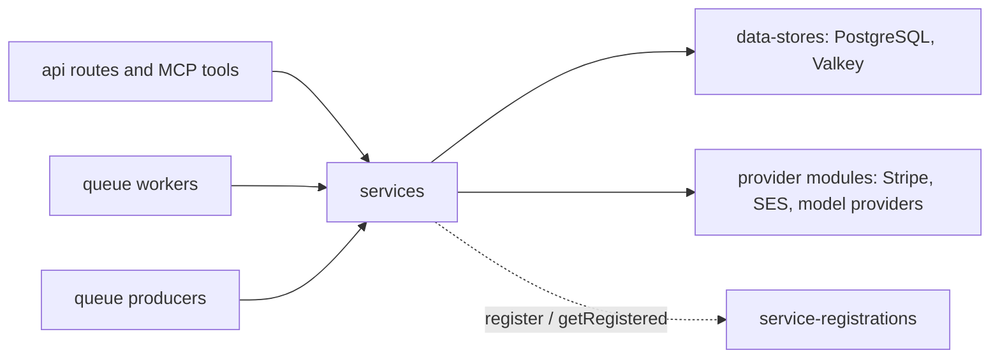

# Services

Orientation for `backend/services/`. Each package carries its own contract in code, tests and
[`backend/services/AGENTS.md`](../../../../backend/services/AGENTS.md); this page says where things
live and why the layering exists. Read the package, not a copy of it.

## Boundaries

- A **service** owns one domain's business rules, its SQL and its external integrations. Routes,
  MCP tools and workers are thin callers, so a rule exists once and REST and MCP cannot diverge.
- A service never reaches into another domain's tables. When a domain is unrelated, it is a new
  service.
- **Queues** (`backend/queues/`) only enqueue; **workers** (`backend/workers/`) only unwrap a job and
  call a service. See the [queues map](../queues/README.md).
- **Data stores** (`backend/data-stores/`) own connection and schema access; services import them,
  never the reverse.

## Where to look

- Identity and access: `users`, `jwt-session`, `oauth*`, `passkeys`, `totp`, `mfa`, `api-keys`,
  `app-attestation`, `captcha`, `recaptcha`, `user-consents`, `account-data-requests`.
- Content: `posts`, `comments`, `stories`, `topics`, `communities`, `lists`, `bookmarks`, `images`,
  `markdown`, `post-publication`, `post-revisions`, `search`, `feeds`, `sitemaps`.
- Social graph and messaging: `entity-relations`, `messaging`, `modmail`, `conversations-messages`,
  `notifications*`, `engagement-emails`.
- Moderation and trust: `moderation-*`, `review-disputes`, `user-warnings`, `copyright-notices`,
  `spam-detection`, `vote-weight`, `vote-integrity`, `elections-votes`, `report-integrity`.
- AI and classification: `classifier-runs`, `classifiers`, `post-classifier`, `autotagger`,
  `ai-usage`, `openai-*`, `bedrock-embeddings*`.
- Crawling and referral links: `crawl*`, `crawler-*`, `urls*`, `rss-feed*`, `referral-*`,
  `*-referral-program-links`.
- Federation: `activitypub-delivery`, `ap-*`, `remote-actors`, `bluesky-*`, `fediverse-*`. See
  [fediverse federation](../fediverse-federation.md).
- Money: `memberships`, `stripe`, `stripe-event-processing`, `user-financial-profiles`. See
  [monetary values](../monetary-values.md).
- Platform: `dynamic-config-*`, `feature-flags`, `queue-domain-controls`, `route-rate-limits`,
  `user-rate-limits`, `data-retention`, `psql-admin`, `valkey-admin`, `session-advisory-lock`.

## Decisions worth knowing

Deleting an image immediately denies delivery and retires its placements. Posts sharing the image
are reset in independent bounded transactions, so popular images cannot hold every post lock in
one transaction. A failed page keeps the image unreadable and its source storage intact until
recovery completes. PostgreSQL owns progress and pending listener admissions; the
[queue continuation](../queues/README.md#why-queues-are-shaped-this-way) is a delivery hint.

List import applies the same post discovery eligibility as list reads, preventing invisible rows
from being copied into a personal list. A shared runtime bound caps post and feed-item import
sources, including the combined feed-item result across source feeds; feed items stay readable only
while a live enabled source feed still supplies them.

Payment operational retention removes finished Stripe event processing work and expired abandoned,
failed, ownerless, or provider-expired purchase launches in bounded, persisted keyset passes.
Launched subscriptions and native purchase tokens remain available to resolve later provider
events. The immutable Stripe event ledger remains the deduplication authority after work is
removed; verification-linked purchase intents remain because their accounting evidence must keep
a valid reference. Failed Stripe processing work remains recoverable until it reaches a completed
or ignored outcome.

Browser device credentials carry refresh authority separately from access authority. The session
service may renew an access credential only after checking device binding, revocation and the
current user; that refresh authority alone never authorizes a mutation. Ordinary authenticated
requests still require a paired device and access credential. Browser-key binding is authoritative
on the PostgreSQL session row; Valkey holds only single-use proof challenges. Renewal checks the
binding under the same row lock as credential rotation, and cache eviction cannot restore an
unbound credential. Credential mint authority also preserves native identity during secure completion
replay; verified native attestation can renew device lifetime without converting a web session. See the [browser auth boundary](../reference-auth-overview-web-client-auth-boundary.md).

The primary session registry also acts as the credential-mint receipt for durable OAuth completion.
A completion interrupted before its first mint can initialize authority only when its SID has no
registry row. Existing rows, including revoked or expired sessions, prevent lost authority from
being recreated. Session rows must therefore remain until user deletion; active-SID pruning would
break this invariant. A registry read failure cannot authorize initialization.

Identity verification keeps a keyed document fingerprint after revocation and account deletion so
the same document cannot verify another account. The domain HMAC key must remain stable while these
hashes are retained: changing it would make older hashes uncheckable because raw document values
are discarded. Fingerprint-key rotation is not implemented.

Moderation reconciliation admits expired and retryable work through the same bounded candidate
page. Terminal dispositions are written only for that admitted page; lease and disposition updates
commit together. Batch embedding listings use a fixed ID boundary and keyset continuation because
polling does not necessarily remove active rows from the work predicate.

Posts owns embedding-trigger bookkeeping alongside deletion so a terminal skip cannot hide a newly
eligible first community post. Community services retain ban-evasion detection policy; the deleted
author tombstone is not a moderation subject. Keeping this boundary avoids a cyclic dependency
between post mutation and community moderation.

Vote-weight maintenance separates indexed trigger selection from idempotent recalculation of current
facts. Source writes enqueue after commit; overlapping windows and transactionally retained dirty
markers provide recovery when publication or timestamp visibility loses a trigger. See
[vote-weight recovery](../queues/README.md#vote-weight-recovery) for continuation and replay semantics.

Data retention bounds pending push work by the intent's creation time, because push work can be
created after its notification. The intent's UUIDv7 `id` carries that time. A persisted cursor
pages by that `id` and keeps a fixed cutoff for each sweep, so a large backlog resumes on the next
scheduled run. The worker enqueues another bounded page when work remains, so a backlog progresses
within the same cleanup cycle.
An active delivery lease is preserved until a later sweep. Endpoint receipts follow their intent's
deletion through the foreign key.

History retention keeps a durable high-water cursor for age-only referral scrubbing, referral
expiry, and pending imports. A completed pass advances its fixed age boundary rather than starting
again at the oldest row. Each bounded page first checks for one still-eligible row behind the
cursor, so a late commit cannot be lost. The referral check uses only rows that still carry URL or
campaign details; once cleared, a retained click does not consume future scrub pages. Histories
whose eligibility can change when a newer same-key row arrives still revisit their raw range.

- **Authorization lives in `authorization.mts` as `currentUserCan*`.** One file per service means
  the REST route, the MCP tool and the worker ask the same question. SQL visibility filters belong
  there too. Branch on `error.name`, `code` or `status`, never `error.message`.
- **Dependency-inversion registries.** A service that needs a handler owned by another service
  exposes `register*()`/`getRegistered*()` instead of importing it, so the workspace dependency
  graph stays acyclic. Because a missing registration is a runtime failure, every process
  entrypoint imports `backend/service-registrations` once; `.no-mistakes.yml` enforces both halves.
- **Dedupe expensive work by content hash.** Moderation and embeddings reuse a result for
  byte-identical input rather than paying the provider twice.
- **Human approval gates AI drafts.** Dispute and appeal responses are drafted by an agent but are
  never delivered until a human approves; final resolution waits for delivery. This is a legal
  invariant of the moderation workflow, not a convenience, and the services enforce it in SQL.
- **Retained identities.** Audit and money rows (memberships, refunds, moderation history) point at
  `retained_user_identities`, so they survive account deletion without authorizing the deleted
  user. See the [PostgreSQL schema rules](../../../development/postgres-schema-rules.md).
- **Classifier runs share one receipt table.** Every fixed classifier uses one lifecycle (receipt,
  lease, attempt cap, completion, sweep) so a new classifier is an adapter plus a row, not a table.
  See the [AI platform](../ai-platform.md).
- **Account linking differs by protocol.** Google and Apple link in one request because the browser
  already holds an ID token. AT Protocol OAuth is a server-side redirect, so linking is two
  functions and a stored authorization row whose callback re-checks the signed-in user; the
  authorization URL is portable, so possession of it must never decide who gets linked.
- **Upload maintenance keeps a frozen work window.** A failed object deletion or an extraction
  that remains pending must not monopolize the oldest page and starve later uploads. Each phase
  therefore resumes through its own staged-time and identity interval, with cutoffs fixed for the
  sweep. Progress follows committed state and attempted external effects; a later scheduled sweep
  retries failed or temporarily locked rows. This is replayable maintenance, not an exactly-once
  guarantee for provider calls. Capturing a new window is read-only; only processing it causes
  deletion or extraction admissions. Recovery admits only its bounded page and saves progress
  after every admission succeeds; an admission failure leaves that phase available for replay.
- **Hash uploads after upload.** The client cannot be trusted to report a hash, and the server has
  to read the bytes to validate format anyway.
- **Referral card catalogs are curated seeds, not scraped,** because the provider's page cannot be
  enumerated reliably by a headless browser.
- **Bloom filters can be rebuilt and lost.** Startup hygiene gives orphaned build keys a TTL so a
  crashed rebuild cannot sit on a no-eviction Valkey forever.

## Related

- [AGENTS.md](../../../../backend/services/AGENTS.md)
- [Queues map](../queues/README.md) and [AI platform](../ai-platform.md)
- [MCP tools](../mcp/README.md) and [API conventions](../../../../backend/api/AGENTS.md)
- Requirements behind the services: [trust system](../../../requirements/trust-safety/reference-trust-system-overview.md)
