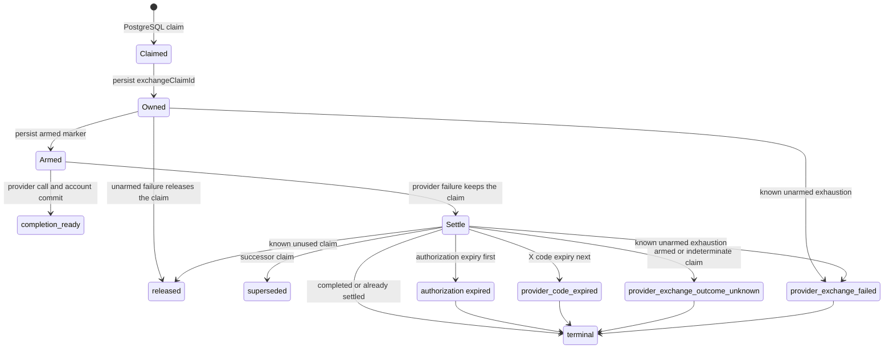

# OAuth

Source entrypoint: [backend/services/oauth/README.md](../../../../../backend/services/oauth/README.md)

Multi-provider OAuth authentication for login, signup, and account linking.

## Shared Authorization Broker

Facebook, X, GitHub, and LinkedIn can use one durable server-begun state machine for web and native
authentication or account connection:

1. `beginOAuthAuthorization` validates purpose ownership, capability, and native proof challenge,
   then persists HMAC state plus an encrypted server PKCE verifier. A new web authentication
   atomically supersedes any unfinished web authentication owned by the same initiating browser
   device/session. Concurrent begins are transaction-lock serialized and a partial unique index
   enforces the single-active-flow invariant, so an opener crash cannot leave a surviving provider
   popup able to rotate the session after its replacement starts.
2. `receiveOAuthAuthorizationCallback` locks the HMAC-selected row, stores the provider code or
   denial plus a stable encrypted completion handoff, and returns only after that write commits.
   Expired callback secret cleanup also commits before the caller receives HTTP 410; a replay of
   an already-completed expired callback returns 410 without rewriting its terminal result.
3. The ID-only `oauth-authorization-exchange` queue claims the row with a fenced UUID. Provider
   calls have a 30-second end-to-end abort budget below the 60-second claim lease, and provider
   account persistence plus `completion_ready` commit in the same transaction. Five failed durable
   claims terminate as `rejected` so bad codes cannot starve recovery. Authorization status is
   generated from lifecycle timestamps. Each claim appends an immutable numbered exchange attempt;
   releasing, superseding, rejecting, expiring, or completing it appends one immutable result.
   `view_oauth_authorization_current_records` projects the active `exchanging` state and total attempt
   count without resetting parent lifecycle facts. Recovery measures the latest attempt's start
   time, and exact claim fencing protects its successor from stale completion or release.
   Claim, release and rejection own READ COMMITTED transactions and acquire the authorization
   base row with `NOWAIT` before reading attempt history. Native contention remains a job failure
   for the existing retry policy, never a successful null claim. Recovery selects two bounded
   provisional buckets, locks their base rows with `SKIP LOCKED`, then re-reads authoritative
   history in a subsequent statement while holding those locks. Busy rows remain eligible for a
   later scan; they are neither rejected nor treated as completed. Status, version and exact claim
   fences remain in each authoritative write. This replaces waiting recovery rather than claiming
   equivalent same-statement EvalPlanQual coverage. Completion and exact replay keep their existing
   authorization and durable-result contracts.
   If durable rejection fails, the worker retains the original exchange failure as cause and the
   rejection failure as an ordered secondary, without attempting release from an unknown outcome.
   A failed release likewise retains the original cause; successful exhausted rejection remains
   terminal.
4. `completeOAuthAuthorization` validates the initiating device/session, completion token source,
   native proof when applicable, and connection owner. It durably records one authentication,
   MFA, or connection result before a non-MFA session is minted, so a rollback cannot leave an
   inaccessible active session. The authenticated result includes UUIDv7 device and session IDs
   allocated while the authorization row is locked; a UUIDv7 initiating device ID is retained.
   Concurrent completion requests and later replays all issue tokens against that one durable pair
   instead of registering additional active sessions.
   Pending clients poll once per second under the route's read quota. An
   expiry-bound, path-scoped HttpOnly web completion cookie remains available for that replay. The
   callback page first delivers a parsed terminal result to its opener. Only after the opener
   confirms receipt does the callback acknowledge completion; acknowledgement atomically consumes
   the durable completion-token hash and clears the cookie. A popup crash before confirmed receipt
   leaves replay available, while a lost acknowledgement after receipt leaves the delivered result
   intact and both credentials expire with the authorization lifecycle. An account connection
   atomically clears
   `users.vote_weight_recalculated_at`, making vote-weight
   recalculation discoverable by its daily dispatcher after a crash or failed immediate enqueue. A
   connected social account with `friends_synced_at = NULL` likewise remains discoverable by the
   nightly friend-sync dispatcher if its immediate best-effort enqueue fails. Completion expiry
   cleanup commits before the caller receives HTTP 410.

All provider/mode capabilities default off in `oauth-authorization-broker` DynamicConfig. A mode is
advertised and begin is accepted only when its operator flag is enabled and that provider's client
ID and exchange secret are both configured. Credential validation finishes before begin supersedes
or persists authorization state. Expired rows are removed by data retention. Until then,
orphan-account cleanup preserves provider accounts referenced by an unexpired authorization so a
completion-ready result remains consumable. See the
[rollout runbook](../../../../operations/oauth-authorization-broker-rollout.md).

The broker re-derives callback work after missed enqueues and retains durable account/client
completion after committed response loss. External authorization codes are one-shot and providers
expose no exchange idempotency key. An interrupted armed request or a lost stale claim has an
unknown outcome and is rejected without another provider call; the member starts a fresh flow.
See [queue-owned exchange continuation](#queue-owned-exchange-continuation) for the canonical
admission, expiry and retained-job recovery contract.

## Provider transport

Apple, GitHub, and X execute in the API process. Their provider-scoped egress flags select either a
guarded direct request or the HTTP CONNECT proxy at request time. The transport never retries a
failed proxied request through the direct path. Direct API OAuth gives each provider network stage
its own 10-second deadline; durable broker exchanges additionally retain their 15/30-second total
budget. GitHub and X authorization codes remain one-time credentials: an ambiguous upstream
failure requires the client to begin a fresh authorization.

## Overview

This service orchestrates OAuth flows across seven providers (Facebook, Apple, Google, X, LinkedIn, Microsoft, GitHub). It handles provider account upserts, connecting OAuth accounts to existing users, and the login/signup flow that creates or finds a user from an OAuth credential. After successful authentication, it issues JWT session tokens and enqueues friend sync jobs for social providers.

## Key Files

- `providers.mts` — Provider registry with table configurations: defines table names, column mappings, and token capabilities for each of the 7 providers
- `upsert-provider-account.mts` — Routes each provider's auth payload to its specific upsert function (delegates to `oauth-facebook`, `oauth-google`, etc.)
- `upsert.mts` — Generic `upsertOAuthAccount()` that handles INSERT/ON CONFLICT for any provider, adapting columns based on token capabilities
- `connect.mts` — `connectOAuthAccountToUser()` links a provider account to an existing user (rejects if already linked to another user); also provides `getOAuthAccountByProviderUserId`
- `flows.mts` — Two main flows: `connectOAuthAccountFlow` (add provider to existing account) and `continueOAuthFlow` (login/signup with provider credentials + token issuance)
- `oauth-flow-result.mts` — MFA preparation and post-commit authenticated token/session issuance
- `authorization-broker.mts` — Server-begun state and callback persistence
- `authorization-exchange.mts` — Fenced provider exchange claims, recovery scans, and expiry cleanup
- `authorization-completion.mts` — Web/native completion secrecy, ownership, and durable replay
- `authorization-completion-acknowledgement.mts` — Terminal web result credential consumption
- `assert-valid-redirect-uri.mts` — Validates OAuth callback URLs against expected origin and provider path
- `jwt.mts` — `decodeJwtPart()` for parsing JWT tokens from providers like Apple

## Providers

| Provider  | Token Storage        | Refresh Token | Friend Sync |
| --------- | -------------------- | ------------- | ----------- |
| Facebook  | Encrypted ciphertext | No            | Yes         |
| Apple     | No                   | No            | No          |
| Google    | No                   | No            | No          |
| X         | Encrypted ciphertext | Yes           | Yes         |
| LinkedIn  | Encrypted ciphertext | Yes           | No          |
| Microsoft | Encrypted ciphertext | Yes           | No          |
| GitHub    | Encrypted ciphertext | Yes           | Yes         |

## Architecture Notes

- Each provider has its own table (`facebook_accounts`, `google_accounts`, etc.) with consistent column naming conventions
- The generic `upsertOAuthAccount` function dynamically builds SQL based on the provider's `hasTokenColumns` and `hasRefreshToken` flags
- Stored social tokens are encrypted with `@modules/token-secrets` before persistence and decrypted only in provider-specific sync code that calls the upstream API.
- Account connection enforces a one-to-one mapping: a provider account can only be linked to one user
- Friend sync is automatically enqueued after login/connect for Facebook, X, and GitHub
- Redirect URI validation ensures callbacks match the expected origin and provider-specific path pattern
- OAuth account linkage atomically marks vote weight for durable dispatcher recovery, then attempts
  an immediate recalculation enqueue after commit

## Boundary

- Provider validation, provider-account upsert, friend-sync enqueue decisions, and token issuance
  orchestration belong here
- API routes own `ctx` interaction, cookie writes, and response serialization

## Related

- Provider-specific services: [docs/overview/architecture/services/oauth-facebook/README.md](../oauth-facebook/README.md), [docs/overview/architecture/services/oauth-google/README.md](../oauth-google/README.md), etc.
- Friend recommendations: [docs/overview/architecture/services/friend-recommendations/README.md](../friend-recommendations/README.md)
- Friend sync jobs: [docs/overview/architecture/queues/find-your-friends/README.md](../../queues/find-your-friends/README.md)
- JWT sessions: [docs/overview/architecture/services/jwt-session/README.md](../jwt-session/README.md)
- Auth overview: [docs/overview/architecture/auth-overview.md](../../auth-overview.md)

## Queue-owned exchange continuation

Exchange jobs persist the authorization ID and claim ID before decrypting. Immediately before
provider admission they persist a secret-free `exchangeProviderRequestArmed` marker. A retry carrying that claim resumes the owned rejection/release, rather than acquiring
a new claim or repeating the provider. The disposition reads current history after acquiring the
base row in a READ COMMITTED transaction; it protects completed authorizations and successor
claims and requires exactly one affected row for an owned mutation. A live claim without persisted
job ownership is an explicit failure, never a successful no-op.

PostgreSQL claim commit and Valkey ownership persistence are not atomic. If the initial
ownership write fails before provider admission, cleanup first rejects an exhausted exact claim
or otherwise releases that unused claim, then propagates the storage error. A response failure
after a committed queue write is also safe: its continuation observes the committed disposition.
Failed rejection/release retains the storage error as primary and the native error as secondary.

Provider admission stores the secret-free armed marker, then revalidates the exact current claim
under READ COMMITTED/NOWAIT before calling the provider. The abort deadline begins before the
initial ownership write and is not restarted after either persistence boundary. Native contention,
stale/expired/superseded authority, or an elapsed deadline cannot admit a provider through that path.
This is a fresh admission check, not an atomic transaction across PostgreSQL, Valkey and the provider.

Authorization expiry precedes all unconsumed dispositions, including `completion_ready`; it clears
callback/completion ciphertext without altering an already consumed `completed` result. X code expiry
comes next. A retained armed marker or an otherwise indeterminate stale claim is then rejected as
`provider_exchange_outcome_unknown`, even at the attempt limit. Only a known unarmed exhausted
claim is rejected as `provider_exchange_failed`.

The dispatcher checks the bounded locked page against actual retained queue jobs before stale
terminalization. Only an exact authorization/job/claim identity with no armed marker in a live or
failed job preserves an unarmed continuation. The failed job is reactivated with its recorded data;
its next attempt disposes only that claim and does not call the provider. A missing job, mismatched
claim, completed job or armed job supplies no such proof, so recovery fails closed rather than
superseding an unknown one-shot exchange. Queue lookup failure rolls back recovery rather than
being interpreted as absence. Known unused claims remain retryable after explicit release; a
crash that loses that proof can conservatively reject an unused code.

Completed authorizations and successors retain exact fencing. Append-only attempt history records
safe release as `failed_at`; a later claim appends a new attempt. The historical successor-fencing
case now uses that explicit safe release rather than silently superseding an unknown stale claim.
No provider result or universal exactly-once guarantee is inferred. All live provider/decrypt failures
retain their raw primary and ordered secondary errors; queue payloads contain no errors or secrets.
