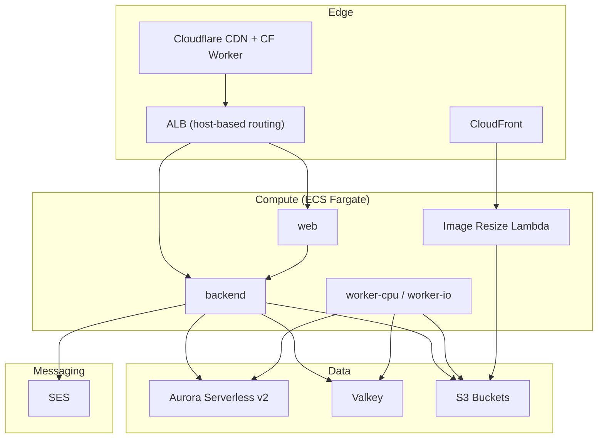

# Infrastructure reference

[Back to Infrastructure](infrastructure.md)

## Architecture Overview

The diagram shows how the edge, compute, and data resources connect; staging and production each provision their own copy of the compute and data tiers behind the same Cloudflare/ALB edge, routed by host header.

Traffic flows: Cloudflare to ALB to ECS Fargate services. Each environment has its own backend, web, and worker services. See [deployment.md](deployment.md) for routing rules.

## ECS Services

The private `vouchington-infra` repository builds and publishes the `api`, `web`, `worker-cpu`, and optional `worker-io` artifacts and is the source of truth for service counts, sizing, autoscaling, and worker queue placement. The Vouchington worker queue policy classifies queue capabilities without selecting a deployed topology. See [Worker Performance](../../development/worker-performance.md).

Staging runs on Fargate Spot for cost control. Production keeps an on-demand baseline for web and api; worker services run Spot-only everywhere because queues self-heal from durable state, so a Spot reclaim is safe.

Tasks run in public subnets with a public IPv4 each, and security groups limit ingress to the ALB. Per-task public IPs were chosen over a managed NAT gateway because the fixed cost is not justified at current scale; revisit if egress allow-listing or task count changes the math.

## Aurora Serverless v2

- Aurora PostgreSQL, versioned to satisfy the backend schema's UUIDv7 helpers and virtual generated columns.
- Auto-pause is enabled in staging for cost control, and staging caps the maximum capacity to bound autoscaler overreaction on a tiny workload.
- Private subnets only; pgvector is installed by migrations.

### Deferred: IAM database authentication

IAM database authentication is intentionally off. Token signing costs nothing, but it adds permanent complexity: two auth paths through the connection layer, mandatory TLS with the RDS CA bundle, a host-aware async token callback for writer versus reader pools, an out-of-band Postgres role bootstrap that neither OpenTofu nor the migration runner can perform, and a code path that only runs against real Aurora. The motivation of avoiding static password copies is partly met already: ECS reads the Aurora-managed Secrets Manager password directly and the backend assembles its connection URL at startup.

Revisit when the static password must be eliminated entirely (zero-secrets posture, compliance, credential staleness during idle periods), when several services or roles need individually revocable database access, or when break-glass revocation without a password reset is required.

## Valkey Strategy

One node-based instance serves every client group per environment. It must be node-based because GlideMQ uses `FUNCTION LOAD`/`FCALL`, which ElastiCache Serverless blocks. All client-group URLs point at the same instance and the backend deduplicates connections by URL and read preference.

Trade-offs: only one eviction policy per instance, so `noeviction` (required by the worker queue and dynamic config) applies to everything and session, cache and rate-limiter keys rely on TTLs; there is no auto-scaling; and append-only persistence for queue durability adds slight overhead to ephemeral groups.

Split the cache, session and rate-limiter groups onto Serverless when cache memory pressure competes with the queue, when they need auto-scaling, or when they need different eviction policies. No data migration is needed: caches rebuild from the database, sessions expire, rate-limiter state is ephemeral and dynamic config reinitializes at startup.

## CloudFront + Lambda (Image Resize)

- A Lambda Function URL sits behind CloudFront using origin access control with IAM authentication.
- The dedicated images origin serves image and sideload paths directly; browser image requests do not traverse the apex Worker.
- Sideload requires signing keys; the image Lambda fetches them from SSM at runtime and fails closed when missing.
