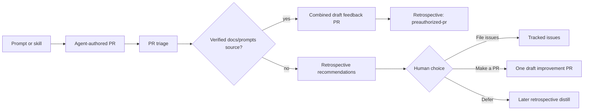

# Automation Prompts

Automation prompt text lives here. The attended triage loop schedules and runs these prompts locally; no GitHub Actions workflow dispatches them.

## Prompt Surfaces

| Surface                    | Source                                                             | Used by                                                                                                                              |
| -------------------------- | ------------------------------------------------------------------ | ------------------------------------------------------------------------------------------------------------------------------------ |
| Code review inline overlay | [code-review-inline-comments.md](code-review-inline-comments.md)   | Default `inline_prompt_path` overlay for the `code-review` composite action; see the file itself for the full contract and consumers |
| Scheduled prompts          | [scheduled/](scheduled/) (indexed in [SCHEDULED.md](SCHEDULED.md)) | The attended triage loop, which schedules and runs them locally                                                                      |
| Automation templates       | [automation templates](automation/README.md)                       | Subagent prompts the attended triage loop fills in and dispatches locally (shepherd, plan, fix, CI failure, scheduled)                                                        |

Automation templates use `{{UPPER_SNAKE_CASE}}` placeholders. The caller substitutes short values inline and supplies multiline or user-provided values from files.

The main-branch fix template is [fix-main.md](automation/fix-main.md), and merge-queue ejections
are triaged with [merge-queue-ejection.md](automation/merge-queue-ejection.md). Both inject the
shared [CI failure core](automation/ci-failure-core.md) as the `CI_FAILURE_CORE` var-file, so they
classify and fix failures by the same rules. Scheduled runs use the
[scheduled prompt template](automation/scheduled-prompt.md) or the
[scheduled issue template](automation/scheduled-issue.md), depending on the selected prompt scope.
See the complete [Scheduled Prompt Catalog](SCHEDULED.md) for all scheduled prompt files and
their scope boundaries; do not maintain a second partial prompt list here.

PR-mode scheduled prompts may complete with one draft PR or, unless the selected prompt explicitly
requires a real patch, a verified no-op after their full required audit and checks. Skipped setup,
diagnostics, or required scope means the run is incomplete,
not a no-op. The shared [scheduled prompt template](automation/scheduled-prompt.md) defines the
outcome report and validates scheduled no-source references before publication.

These templates are Vitest fixtures, not docs-only markdown, so changes under this tree run the tooling test suites ([area test suites](../development/ci.md#area-test-suites)).

## Agent-Authored PR Feedback Loop

PR-triage skills use the canonical
[agent-authored PR creation feedback](../../.agents/skills/agent-workflow/code-review.md#agent-authored-pr-creation-feedback)
rubric to turn evidence from generated PRs into improvements to their verified
source prompt, producing skill, or shared workflow. `/triage-prs` automatically combines actionable,
verified `docs/prompts/**` findings from its batch into one draft feedback PR with its plan stored outside Git;
other sources keep the normal human disposition. Individual scheduled prompt bodies change only when
evidence identifies that exact prompt as the source.

